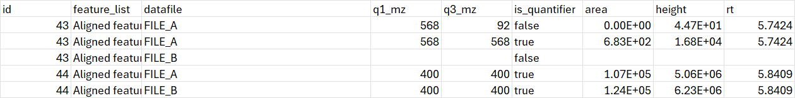

# Export MRMs to TSV

!!! warning

    To process multiple reaction monitoring (MRM) data, the MRM service of mzmine is required. This feature is
    included in the mzmine PRO subscription. Academic program and other users can reach out to inquire
    [access options](https://mzio.io/#contact).

The Export MRMs to TSV module exports MRM transition measurements from an MRM feature list to a
tab-separated (`.tsv`) or comma-separated (`.csv`) table. Run
[Set MRM quantifiers](../mrm_setquant/mrm-set-quant-mass.md) before export when you need to identify
the transition selected for quantification.

The export writes one row for every transition in each feature-list row and raw data file. Its
`is_quantifier` column marks the transition selected as the quantifier; `area`, `height`, and `rt`
refer to that individual transition within the feature's retention-time range. Thus, use the row
whose `is_quantifier` value is `true` when exporting quantifier areas; the table also retains the
other transitions for review.
An exemplary export is shown below:

**Figure 1:** Example export result with [Skip missing features](#skip-missing-features) disabled.

## Parameters 

#### Feature lists
Select MRM feature lists to export. The list must contain MRM transition data; a conventional
feature list without transitions cannot be exported by this module.

#### Export file

Choose the output file. Use a `.tsv` name for tab-separated output or `.csv` for comma-separated
output. When exporting several selected lists, include `{}` in the file name to substitute each
feature-list name and avoid overwriting a previous export.

#### Skip missing features

This option is intended to omit the placeholder row for a feature that was not detected in a
particular raw data file. With the option disabled, the export retains one row containing the
feature-list row ID and raw-file name but empty transition, area, height, and RT values. This
makes absent measurements explicit when importing the table into downstream software.

In the documented application snapshot, the option does not yet suppress those placeholder rows;
plan for them when importing the export.

---

{{ git_page_authors }}
