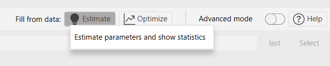
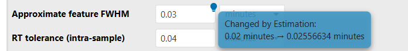
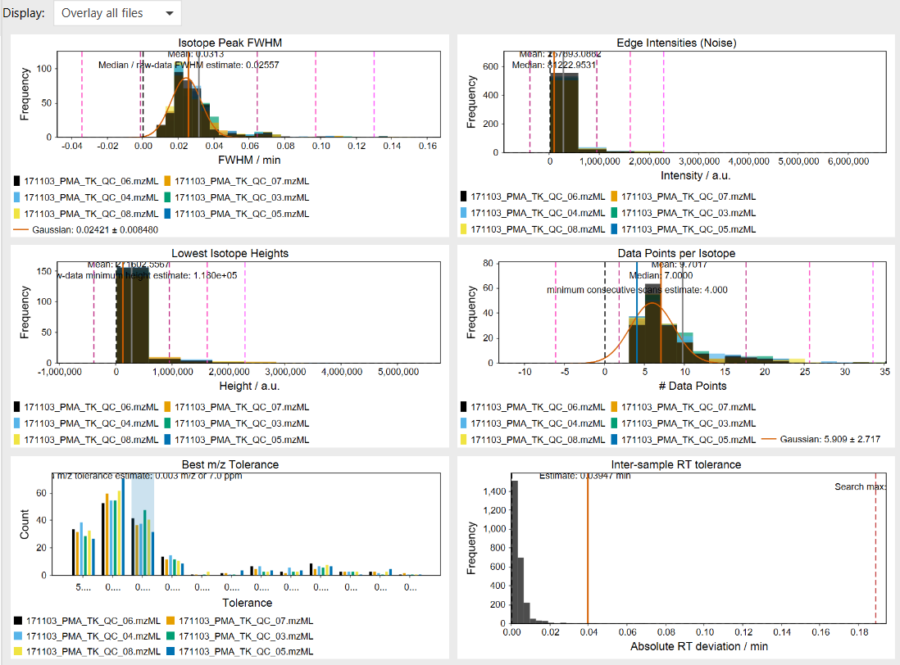

# Estimate wizard parameters

:material-menu-open: **Processing wizard → Fill from data: → Estimate**

**Estimate** measures the selected raw data files once and writes the results into the
[processing wizard](../../wizard.md), for example the peak width, noise level, m/z tolerance and
minimum feature height. No processing batch runs, so estimation usually takes from seconds. The
button sits next to the label **Fill from data:** in the wizard's tab header.

The estimates are also the starting point of [Optimize](wizard_optimize.md), which then tests and
improves them by running the wizard workflow repeatedly.

Estimation starts from the **presets** you selected in the wizard (sample introduction, ion
mobility,
MS instrument, workflow). Select the closest presets first, then click **Estimate**.

Estimation supports chromatography (LC and GC), direct infusion and flow injection data. It does
**not**
support MALDI, LDI, DESI, SIMS, or imaging data.

!!! danger

    **Treat the estimates as estimates**, not as perfect parameters for your application. The estimation 
    is based on a "default" metabolomics workflow with a limited amount of datasets.  

!!! info

    - The analysis **replaces the MS1 mass lists** of these files, so earlier mass detection
      results on those scans are lost. Run [mass detection](../../module_docs/featdet_mass_detection/mass-detection.md)
      again if you need your own mass lists for these files.
    - Estimation **resets the wizard's Customization step** (see
      [Reviewing the changes](#reviewing-the-changes)).

---

## Representative files {#representative-files}

Estimation and optimization do not use all files from the wizard's data import step. They use a
small representative subset, at most **10 files**, selected by file name:

1. If at least 3 file names look like QC samples (e.g., `QC`, `pooled_QC`, `QC_pool`), up to 10 of
   them are selected at random.
2. Otherwise, if more than 3 files are not named as blanks (`blank`, `blk`, `media`), the first 10
   of them in the import list are used.
3. Otherwise, up to 10 of all files are selected at random, blanks included.

Because of the random selection, two runs can use different files when there are more than 10
candidates. Estimation needs at least 1 file, [optimization](wizard_optimize.md) at least 3.

!!! info

    Some estimates need more than one file. The sample-to-sample m/z and RT tolerances need
    features aligned across at least two files. The retention time correction decision needs at
    least three files. With too few files, these parameters keep their current values.

---

## Running the estimation

Click **Estimate** to fill the wizard from the raw data. To also open the
[Data file statistics](#data-file-statistics) dashboard, right-click the button and choose
**Estimate parameters and show statistics**.

There is no settings dialog. Before each run, an information dialog reminds you that estimation
replaces mass detection results, changes the wizard settings and drops the Customization step.
Select **Don't show again** to skip it in the future.

### Suggested preset changes {#suggested-preset-changes}

If other wizard presets fit the data better, a **Switch wizard presets** dialog lists each change
and its reason. Clicking **Yes** switches the presets **immediately**. The new presets start from
their **default** values, and the estimates are applied on top, so any edits you made to the
replaced
presets are **lost**. Clicking **No** keeps your presets and estimates the parameters for them.

| Wizard part         | Suggestion                                                                                                                                                                                                                                                                                                                                    |
|---------------------|-----------------------------------------------------------------------------------------------------------------------------------------------------------------------------------------------------------------------------------------------------------------------------------------------------------------------------------------------|
| Sample introduction | For HPLC, UHPLC and HILIC: *Flow injection* if broad signals dominate every file (at least 3 signals per file that span more than 15% of the run, and at least 80% of all signals).   Otherwise, only for HPLC and UHPLC: the one of these two presets whose default FWHM is closest to the measured median peak width.                    |
| Ion mobility        | *No IMS* if (some) files have no ion mobility data. Otherwise the preset matching the mobility type in the files (TIMS, DTIMS, TWIMS, SLIM, other IMS).   Mixed mobility types only produce a warning.                                                                                                                                     |
| MS instrument       | The first allowed instrument if the ion mobility preset does not allow the selected one (e.g., TWIMS requires QTOF). Otherwise only for QTOF and Orbitrap: *Low res.* if the isotope signals need an m/z tolerance wider than 0.015 m/z / 25 ppm, *Orbitrap* if the scans have injection times (Bruker TDF files excluded) and *QTOF* if not. |

If a preset may be unsuitable but no better one exists, a **Check wizard presets** dialog shows a
warning and the presets are kept.

### Estimated parameters {#estimated-parameters}

Only parameters that apply to the selected presets are estimated. If the data cannot support an
estimate, the parameter keeps its current value.

| Wizard step → parameter                                               | How it is estimated                                                                                                                                                                                                                                                              |
|-----------------------------------------------------------------------|----------------------------------------------------------------------------------------------------------------------------------------------------------------------------------------------------------------------------------------------------------------------------------|
| Sample introduction → **Approximate feature FWHM**                    | Median FWHM of all isotope traces found in the raw data. HPLC, UHPLC, HILIC, GC-CI and GC-EI only.                                                                                                                                                                               |
| Sample introduction → **Minimum consecutive scans**                   | Half the median number of scans across the weakest detected isotope peaks, rounded.                                                                                                                                                                                              |
| Sample introduction → **RT tolerance (sample-to-sample)**             | 98th percentile of the RT deviations of features aligned across the representative files. Needs at least 2 files.                                                                                                                                                                |
| Sample introduction → **Apply Retention time correction**             | Switched on if one file's median RT shift is clearly larger than the others': more than 3× the median shift of all files *and* more than half the estimated FWHM. Needs at least 3 files.                                                                                        |
| Sample introduction → **Crop retention time**                         | Median start and end of the usable chromatographic run across files, from [run phase detection](#run-phase-detection). If no run phases are found in at least half of the files, the full RT range is used. LC presets only.                                                     |
| MS → **Ion mode**                                                     | The polarity decided during [classification](#polarity).                                                                                                                                                                                                                         |
| MS → **Noise threshold**                                              | *Absolute intensity* detector: the 7th percentile of the intensities where isotope traces fade into noise. *Factor of lowest signal* detector: a fixed factor of 5. In both cases the MS2 level is set to the MS1 level / 2.5. The detector type selected in the wizard is kept. |
| MS → **Minimum feature height**                                       | Median height of the weakest isotope of each envelope. For data with injection times (not IMS), heights are normalized to the median MS1 injection time.                                                                                                                         |
| MS → **Scan-to-scan m/z tolerance**                                   | For each seed signal, the narrowest of 12 predefined tolerances that captures the most correlated isotopes. The most frequent of these, plus one step wider, is used, limited to a range suitable for the instrument.                                                            |
| MS → **Sample-to-sample m/z tolerance**                               | Smallest predefined tolerance that covers 80% of the features aligned across files. Needs at least 2 files.                                                                                                                                                                      |
| Customization → Local minimum resolver **Min ratio of peak top/edge** | Fixed value 1.7 (HPLC, UHPLC, HILIC, GC-CI).                                                                                                                                                                                                                                     |
| Customization → Local minimum resolver **Chromatographic threshold**  | Fixed value 0.85 (HPLC, UHPLC, HILIC, GC-CI).                                                                                                                                                                                                                                    |

With direct infusion and flow injection presets, only the MS step parameters are estimated, and
the broad signals described in [Raw data statistics](#raw-data-statistics) are used instead of the
chromatographic peaks.

The mobility FWHM in the ion mobility step is **not** estimated. Estimation keeps it unchanged, but
[Optimize](wizard_optimize.md) can optimize it.

The predefined m/z tolerances, from narrow to wide, are:
0.0005 m/z or 2 ppm, 0.001 m/z or 5 ppm, 0.003 m/z or 7 ppm, 0.005 m/z or 15 ppm, 0.008 m/z or 15
ppm, 0.01 m/z or 20 ppm, 0.015 m/z or 25 ppm, 0.02 m/z or 25 ppm, 0.05 m/z or 25 ppm, 0.1 m/z or 25
ppm, 0.3 m/z or 25 ppm, 0.5 m/z or 25 ppm. Ion mobility files only test tolerances up to 0.015 m/z
or
25 ppm.

### Reviewing the changes {#reviewing-the-changes}

No summary dialog appears when estimation finishes. Instead:

- Each changed parameter is marked with a lightbulb icon. Its tooltip shows the old and new value,
  e.g., *Changed by Estimation: 0.1 → 0.07*.
- Each wizard tab with changed parameters shows a checkmark in its header.
- The marks disappear when you create a batch, load a preset, select another preset in that tab,
  or run Estimate/Optimize again.

- 

!!! warning

    Estimate and Optimize **reset the Customization step** before writing their values. All
    overrides that were in it before, including ones you added yourself, are removed. With the
    HPLC, UHPLC, HILIC and GC-CI presets, the Customization step afterwards contains fixed
    values for the local minimum resolver, and **Advanced mode** is switched on so you can see them.
    With other presets the Customization step stays empty and **Advanced mode** is switched off.
    These overrides replace the values that the wizard would otherwise calculate for the local
    minimum resolver. To return to the calculated values, remove the overrides or disable the
    Customization step.

!!! danger

    Estimated values are a starting point, not a guarantee. Check them, especially the noise level, 
    minimum feature height, and RT crop range in the [raw data overview](../../visualization_modules/raw_data_overview/raw_data_overview.md)
    and the resulting feature lists.

---

## Data file statistics {#data-file-statistics}

:material-menu-open: **Tools → Data file statistics**, or right-click **Estimate** in the wizard →
**Estimate parameters and show statistics**

This dashboard shows the raw data statistics behind the estimates. Opened from the Tools menu, it
analyses the selected raw data files without changing any parameters. It takes these parameters:

- **Raw data files**: the files to analyse.
- **Polarity**: only MS1 scans of this polarity are used. Required for polarity-switching data.

!!! warning

    Like the wizard estimation, this module replaces the MS1 mass lists of the analysed files.

Use **Display** to show a single file (select it in **File**), overlay all files, or accumulate all
files into one distribution. Each histogram shows mean and median markers, ±1σ/2σ/3σ lines and,
where applicable, the estimate that the wizard uses. The peak width and data point histograms
also show a Gaussian fit. Charts can be exported from their context menu.

| Chart                     | Shows                                                             | Wizard estimate                                                                                             |
|---------------------------|-------------------------------------------------------------------|-------------------------------------------------------------------------------------------------------------|
| Isotope Peak FWHM         | Peak width of the isotope traces                                  | Median → Approximate feature FWHM                                                                           |
| Edge Intensities (Noise)  | Intensities where isotope traces fade into noise                  | 7th percentile → MS1 noise level (absolute intensity detector only)                                         |
| Lowest Isotope Heights    | Height of the weakest isotope per envelope                        | Median → Minimum feature height                                                                             |
| Data Points per Isotope   | Scans across the weakest isotope peaks                            | Half the median → Minimum consecutive scans                                                                 |
| Best m/z Tolerance        | How often each predefined tolerance was the best one              | One step wider than the most frequent → Scan-to-scan m/z tolerance                                          |
| Inter-sample RT tolerance | RT deviations of features aligned across files (at least 2 files) | 98th percentile → RT tolerance (sample-to-sample); the dashed line marks the optimizer's upper search limit |

The values in the wizard can differ slightly from the dashboard markers: the wizard ignores zero or
invalid values and limits the m/z tolerance to the instrument's range.

---

## Algorithm {#algorithm}

### Raw data statistics

For each representative file, mzmine:

1. Detects masses in all MS1 scans of the selected polarity with a noise level of 0. For ion
   mobility files without frame spectra, the mobility scans are merged into frames first.
2. Detects the [run phases](#run-phase-detection).
3. Picks seed signals: the base peak of every MS1 scan and two further peaks per scan that are at
   least 10 m/z apart, at most one seed per 1 m/z bin. Benchmark features of the
   [optimizer](wizard_optimize.md), if provided, are added.
4. For each seed and each predefined m/z tolerance: extracts the ion chromatogram and bounds the
   peak at 5% of the apex intensity. Peaks with fewer than 5 scans are discarded. Then up to 4 ¹³C
   isotope signals are searched in the apex scan. Isotope traces are kept while their shape
   correlates with the main peak (Pearson r > 0.8).
5. Keeps the best isotope envelope of each seed (most isotopes, then highest correlation) and the
   tolerance that produced it. Envelopes whose peak spans more than 15% of the run are kept apart
   as broad signals, unless the same seed also gave a narrower envelope.

The FWHM, noise, height, data point and m/z tolerance statistics are calculated from the narrow
envelopes. With a direct infusion or flow injection preset, they are calculated from the broad
signals instead. The broad signals also decide whether *Flow injection* is
[suggested](#suggested-preset-changes). If no file contains isotope envelopes, the estimation
stops.

With at least two files, the best envelopes of all files are aligned (0.02 m/z / 10 ppm, 0.2 min).
Rows found in at least 80% of the files give the RT deviations and the sample-to-sample m/z
tolerance.

### Run phase detection {#run-phase-detection}

For files with at least 20 MS1 scans, mzmine looks for:

- the start of flow after a divert or no-flow segment,
- the void volume (a strong drop of background ions in the first 30% of the run),
- salt or calibrant plugs (sodium formate clusters) at the start and end of the run,
- the start of the re-equilibration, based on background ions and, if the file stores them, LC pump
  traces (solvent composition and pressure).

The usable range starts after the latest of flow start, void volume and early salt plug. It ends at
the late salt plug or the start of re-equilibration. The median across files becomes **Crop
retention time**.

### Polarity switching {#polarity}

Each wizard run processes a **single** polarity. Before the statistics are computed, the files are
classified by polarity. The wizard may show an error or automatically change the polarity setting to
create a working wizard preset.

- **Only single-polarity files of one kind**, with the wizard **Ion mode** set to *No filter*: the
  ion mode is set to that polarity.
- **Polarity-switching files** (positive and negative scans in one file), with *No filter*: a dialog
  asks which ion mode to estimate and optimize for.
- **Polarity-switching files mixed with single-polarity files of one kind**, with *No filter*: the
  ion mode is set to that single polarity without asking.
- **No file contains polarity information**: *No filter* is kept.
- **Positive-only and negative-only files mixed**, files without the polarity chosen in the wizard,
  or files without polarity information mixed with files that have it: the action stops with an
  error. Process these files in separate wizard runs.

---

## Errors and warnings {#errors-and-warnings}

| Message                                                                              | Cause and solution                                                                                                                           |
|--------------------------------------------------------------------------------------|----------------------------------------------------------------------------------------------------------------------------------------------|
| *Select at least one raw data file in the Data Import step first.*                   | Add files to the wizard's data import step.                                                                                                  |
| *Cannot start estimation or optimization while another Batch is running.*            | Wait for the batch to finish or cancel it.                                                                                                   |
| *Parameter estimation and optimization do not support imaging workflows.*            | Imaging data cannot be estimated. Review the wizard settings manually.                                                                       |
| *No suitable isotope-supported signals were found for the selected wizard workflow.* | No isotope envelopes were found. Check polarity, data quality, the selected sample introduction preset, and that the files contain MS1 data. |
| *Could not start the raw data import.* / *The raw data import failed.*               | Check the files and the metadata file of the data import step.                                                                               |
| *None of the selected wizard files could be imported.*                               | Check the files and the metadata file of the data import step.                                                                               |
| *Raw data files missing* (notification)                                              | Some files could not be imported; the remaining files are used.                                                                              |
| *Skipped raw data files* (notification)                                              | Statistics failed for some files; the remaining files are used.                                                                              |
| Polarity conflict                                                                    | See [Polarity](#polarity).                                                                                                                   |

---

{{ git_page_authors }}
