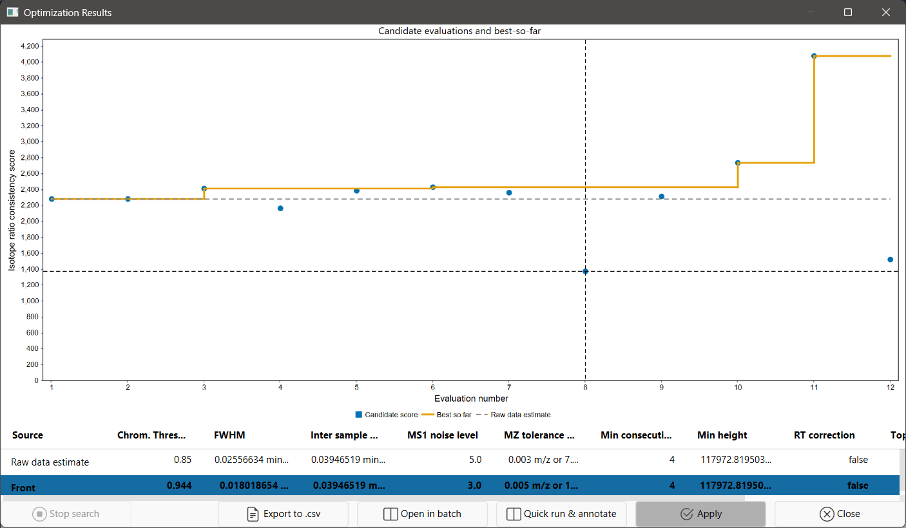
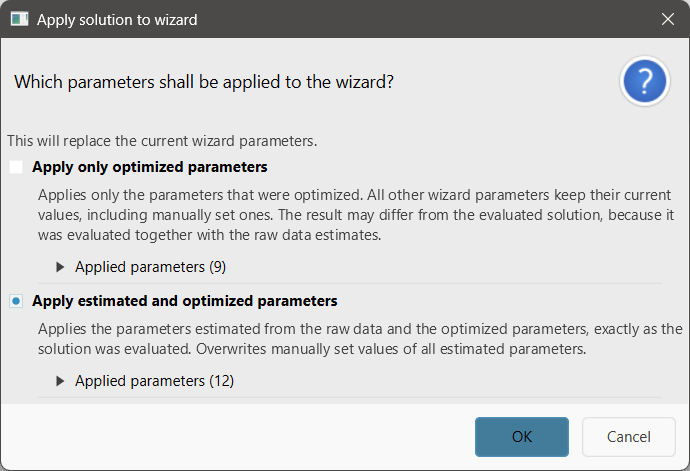

# Optimize wizard parameters

:material-menu-open: **Processing wizard → Fill from data: → Optimize**

!!! danger

    The parameter optimization will **mathematically** optimize parameters to achieve a maximum 
    score function. These score functions can reward low noise levels and minimum heights, which increases RAM 
    consumption in large datasets. Evaluate the detection thresholds before running large datasets. <br>

**Optimize** searches for better [processing wizard](../../wizard.md) parameters. It starts from the
[raw data estimate](wizard_estimate.md) and **default presets** and then runs the wizard workflow
repeatedly on a small set
of representative files. Each run tries different parameter values and is scored by a quality
metric. In a results window you can compare the solutions, then apply one to the wizard or open it
as a batch. Depending on the data and the iteration budget, optimization can take several minutes up
to hours. The button sits next to the label **Fill from data:** in the wizard's tab header.

Optimization starts from the presets you selected in the wizard (sample introduction, ion mobility,
MS instrument, workflow). Select the closest presets first, then click **Optimize**.

!!! info

    - **Optimize** is disabled while an estimation or optimization is running, and when an imaging
    sample introduction is selected (MALDI, LDI, DESI, SIMS). Imaging data are not supported.
    - The representative files are **imported into the current project** and stay there. Their MS1
      mass lists are replaced, as described for the [estimation](wizard_estimate.md).
    - Applying a solution **resets the wizard's Customization step** (see
      [Applying a solution](#applying-a-solution)).

## Recommended citations

!!! info

    When optimizing with the **IPO isotope score**, please consider citing:<br>
    Libiseller G., Dvorzak M., Kleb U., et al. IPO: a tool for automated optimization of XCMS parameters. BMC Bioinformatics 16, 118 (2015). https://doi.org/10.1186/s12859-015-0562-8

    When optimizing with the **Integration score**, please consider citing:<br>
    Delabriere A., Warmer P., Brennsteiner V., Zamboni N. SLAW: A Scalable and Self-Optimizing Processing Workflow for Untargeted LC-MS. Anal. Chem. 93, 15024–15032 (2021). https://doi.org/10.1021/acs.analchem.1c02687

    When optimizing with the **Isotope ratio consistency score (default)**:<br>
    Abiedad Y.E. (unpublished, to be added)

---

## Running the optimization

Optimize needs at least **3 raw data files** in the wizard's data import step. It uses the same
[representative files](wizard_estimate.md#representative-files) (at most 10) and the same
[polarity checks](wizard_estimate.md#polarity) as the estimation.

1. Click **Optimize** and select the [parameters to optimize](#parameters-to-optimize) in the
   setup dialog. To change additional [optimizer settings](#parameters), right-click **Optimize**
   and choose **Optimize with advanced settings** instead. Cancelling the dialog imports nothing.
2. The representative files are imported and classified. For polarity-switching data, a dialog asks
   which ion mode to optimize for.
3. The raw data statistics and estimates are computed. If other presets fit the data better, the
   [Switch wizard presets](wizard_estimate.md#suggested-preset-changes) dialog appears.
4. The workflow runs once with the raw data estimate. Then the [results window](#results-window)
   opens and the search starts.

The simple setup uses these settings:

- **Optimizer**: Pattern search with the *Isotope ratio consistency score*.
- **Iterations**: 7 × the number of selected parameters, at least 30.
- **Max shape rejection factor**: 1.5.
- No benchmark features, no extended statistics, no evaluation of the initial user settings.

---

## Parameters {#parameters}

The advanced setup (right-click **Optimize** → **Optimize with advanced settings**) shows all
parameters. The simple setup only shows [Parameters to optimize](#parameters-to-optimize).

#### Optimizer

The search algorithm, with its own settings. See [Algorithms](#algorithms).

- **Pattern search** (default): optimizes one target.
    - **Optimization target**: the quality metric to maximize or minimize. Default: *Isotope ratio
      consistency score*.
- **MOEA/D**: optimizes several targets at once and returns a set of trade-off solutions.
    - **Optimization targets**: the quality metrics, each a separate objective. Default: *Isotope
      ratio consistency score*.
    - **Raw data-based initialization** _(Optional, on by default)_: starts the population around
      the
      raw data estimate rather than at random. The sampling method is *Independent draws* (default),
      *Latin hypercube* or *Sobol sequence*.

#### Iterations

Maximum number of full batch runs, **including** the run with the raw data estimate.
Default 70, minimum 30, maximum 10,000. There is no time limit. Use
[Stop search](#results-window) to finish early.

#### Max shape rejection factor _(Optional, on by default)_

Rejects parameter sets that produce many badly shaped peaks. Metrics that reward detecting more
signals can be "improved" by picking up noise, which this limit prevents. For each solution, mzmine
determines the share of features that a strict peak-shape filter would remove. A solution is
infeasible if this share exceeds the share of the raw data estimate × this factor (the limit is at
least 5%). The estimate is always feasible. This constraint does not change any score.
Default 1.5, range 1–100.

#### Parameters to optimize {#parameters-to-optimize}

The parameters the optimizer changes. All other
[estimated parameters](wizard_estimate.md#estimated-parameters) are fixed at their estimate. The
list shows only parameters that apply to the selected wizard presets. If the presets are switched
after this dialog, selected parameters that no longer apply are skipped.

| Parameter                 | Selected by default | Applies to                       | Search range                                                                                                  |
|---------------------------|---------------------|----------------------------------|---------------------------------------------------------------------------------------------------------------|
| FWHM                      | yes                 | HPLC, UHPLC, HILIC, GC-CI, GC-EI | from the low (5%) quantile of the measured peak widths up to the larger of the 90% quantile and 2× the median |
| Min consecutive           | yes                 | LC and GC presets                | 3 up to the larger of 9 and the 80% quantile                                                                  |
| Inter sample RT tolerance | yes                 | LC and GC presets                | measured RT deviations, up to 2× the maximum                                                                  |
| RT correction             | yes                 | HPLC, UHPLC, HILIC, GC-CI        | off / on                                                                                                      |
| Min height                | yes                 | all                              | 5%–95% quantile of measured heights (log scale)                                                               |
| MS1 noise level           | yes                 | all                              | *absolute*: 5%–95% quantile of noise intensities (log scale); *factor of lowest signal*: 3–15                 |
| MZ tolerance option       | yes                 | all                              | the predefined m/z tolerances, limited to the instrument's range                                              |
| FWHM (mobility)           | yes                 | ion mobility presets             | depends on the IMS type, e.g., TIMS 0.003–0.02                                                                |
| Top-to-edge ratio         | yes                 | HPLC, UHPLC, HILIC, GC-CI        | 1.5–3                                                                                                         |
| Chrom. Threshold          | yes                 | HPLC, UHPLC, HILIC, GC-CI        | 0.5–0.97                                                                                                      |

Crop retention time, Sample-to-sample m/z tolerance and Ion mode are estimated but never optimized.

!!! tip

    Each selected parameter enlarges the search space. With a small iteration budget, optimize only
    the parameters you are unsure about.

#### Show extended statistics

Opens the [Data file statistics](wizard_estimate.md#data-file-statistics) dashboard and shows
**all** evaluated solutions with diagnostic columns in the results window. If it is off, only the
raw data estimate and the best solutions are shown. Default: off.

#### Evaluate initial user settings

Runs one additional batch with the wizard settings as they were before the optimization started,
including values you changed by hand. The result is shown as the row *Initial user settings* for
comparison. It is never ranked as a solution and cannot be applied. This batch does not count
towards **Iterations**. Default: off.

#### Benchmark features _(Optional)_

A CSV or TSV file with known features, one per row. The separator is detected automatically. RT is
in minutes. Example:

```
mz,rt
195.0877,3.42
304.2985,7.81
```

- **Benchmark file**: the file with the benchmark features.
- **CSV column names**: column headers of the file. The defaults are `mz` and `rt` (both required),
  and `mobility` (optional, off by default). Column names are matched case-insensitively.

The benchmark features are added as extra seed signals for the
[raw data statistics](wizard_estimate.md#algorithm). The results window counts how many benchmark
features each solution detects (column **Target features**). These features are matched with
0.01 m/z, 0.08 min, and 1 mobility unit.

---

## Optimization targets (metrics) {#metrics}

| Metric                              | Direction | What it measures                                                                                                                                                                                                                                                                                                                                 |
|-------------------------------------|-----------|--------------------------------------------------------------------------------------------------------------------------------------------------------------------------------------------------------------------------------------------------------------------------------------------------------------------------------------------------|
| **Isotope ratio consistency score** | maximize  | Rewards features whose isotope ratios agree across files (within 20%). An isotope ratio counts only if it agrees in at least half of the row's files. Features below the 3% height quantile are ignored. Score = (number of consistent isotope ratios)² / total features. Recommended default, and used to sort the results when it is selected. |
| **IPO isotope score**               | maximize  | Per file: (features with an isotope pattern)² / (features above the 3% height quantile), summed over files. After IPO.                                                                                                                                                                                                                           |
| **Integration score**               | maximize  | (rows found in all files with area RSD ≤ 20%)² / total rows. Assumes replicate-like samples. After SLAW.                                                                                                                                                                                                                                         |
| **Fill ratio**                      | maximize  | Detected features / (rows × files).                                                                                                                                                                                                                                                                                                              |
| **Benchmark target count**          | maximize  | Number of reference isotope traces from the raw data statistics that are found in the result.                                                                                                                                                                                                                                                    |
| **Double peak ratio**               | minimize  | Share of features classified as double peaks. Only meaningful when the wizard filter **Apply strict shape filtering** is enabled.                                                                                                                                                                                                                |
| **GC-EI fragment spectrum quality** | maximize  | (rows whose fragment spectrum has more than 10 signals)² / rows. For GC-EI spectral deconvolution workflows.                                                                                                                                                                                                                                     |

!!! tip

    Metrics that count features can be raised by detecting noise. Keep **Max shape rejection
    factor** enabled, or combine such metrics with the isotope ratio consistency score.

---

## Algorithms {#algorithms}

**Pattern search** starts from the raw data estimate and changes one parameter at a time, trying a
step up and a step down. Each step starts at 20% of the parameter's search range. If neither
direction improves the score, the step for that parameter is halved. When all steps are minimal and
nothing improves, the search restarts from nearby points. Pattern search is deterministic and
usually improves quickly, which suits small budgets. Use it when you have one target.

**MOEA/D** is an evolutionary multi-objective algorithm with a population of 20 solutions. With raw
data-based initialization, it starts with the estimate and 19 variations of it. It returns a Pareto
front, a set of solutions where none is better in all targets. Use it when you want to weigh several
targets against each other. **The initial population alone uses up to 20 batch runs**.

Random choices use a fixed seed, so the same files and settings give the same result. Note that
the [representative files](wizard_estimate.md#representative-files) can be selected at random, so
a new run may use different files.

### What happens during an evaluation

For each candidate, mzmine:

1. builds the wizard workflow from the **preset defaults** of the selected presets, applies the
   estimates and the candidate's values. Only the data import settings are taken from your wizard,
2. runs the batch on the representative files in the current project, **without** these steps:
   gap filling, feature list rows filter, correlation grouping, ion identity networking, isotope
   grouping, compound grouping, lipid annotation, spectral library search, spectral networking,
   auto-save, and export,
3. scores the final feature list, then removes all feature lists created by that run.

During the optimization, all data is kept in memory (RAM).

!!! warning

    - Values you changed by hand in the wizard are **not** used during the search, because each
      candidate starts from the preset defaults. When you later [apply a solution](#applying-a-solution),
      your other wizard edits are kept, so the final batch may differ from the evaluated one. Use
      [Evaluate initial user settings](#evaluate-initial-user-settings) to compare your own
      settings with the solutions.
    - Do not start other batches while the optimization runs. Only one batch can run at a time, so
      the optimization's next evaluation would fail.

---

## Results window {#results-window}

The results window opens after the raw data estimate has been evaluated and updates after each
evaluation.

- **Chart**: *Candidate evaluations and best-so-far*. Shows the score of each candidate, the best
  feasible score so far, and the raw data estimate as a dashed line. For MOEA/D, only the first
  target is plotted.
- **Table**: one row per solution, with these columns:
    - **Source**: *Raw data estimate*, *Initial user settings*, *Front* (best solutions) or
      *Evaluated*.
    - The optimized parameter values.
    - One column per target, with bars.
    - **Target features**: number of benchmark features found.
    - In extended mode also *Origin*, *Evaluation*, run times, cache hits, feature counts and the
      shape and precision diagnostics.



When the search ends, a dialog *Optimization finished* appears and the best solution is selected
and shown in bold. For a single target, this is the solution with the best score. For several
targets, it is the solution with the best average rank across all targets.

| Button                   | Action                                                                                                                                                                                                                                                                         |
|--------------------------|--------------------------------------------------------------------------------------------------------------------------------------------------------------------------------------------------------------------------------------------------------------------------------|
| **Stop search**          | Finishes the running batch, starts no new candidate, and keeps all results.                                                                                                                                                                                                    |
| **Export to .csv**       | Saves the shown rows to a CSV file, with the values as shown in the table.                                                                                                                                                                                                     |
| **Open in batch**        | Applies the selected solution to the wizard and opens the full wizard batch (with all steps) in the batch mode dialog.                                                                                                                                                         |
| **Quick run & annotate** | Applies the selected solution to the wizard and runs the full batch on **all** wizard files. Rows that match benchmark features are annotated as *target feature*. A copy of the feature list with the suffix *target* holds the rows that match the reference isotope traces. |
| **Apply**                | Applies the selected solution to the wizard.                                                                                                                                                                                                                                   |
| **Close**                | Stops the search and closes the window, like the window's close button. The batch that is running finishes first.                                                                                                                                                              |

**Open in batch**, **Quick run & annotate** and **Apply** are only available after the search has
ended, and not for the *Initial user settings* row.

!!! tip

    Use **Stop search** to end the optimization early but keep the window open to compare and apply
    the results.

### Applying a solution {#applying-a-solution}

**Apply**, **Open in batch** and **Quick run & annotate** replace wizard parameters.

If you selected other wizard presets after the optimization, mzmine first offers to switch back to
the presets the solutions were evaluated with. Solutions are not applied to other presets.

Then a dialog asks which values to write. Expand **Applied parameters** below an option to see the
values it writes.



- **Apply estimated and optimized parameters** (default): the solution's optimized values and all
  other [estimates](wizard_estimate.md#estimated-parameters), exactly as the solution was
  evaluated. Values you set by hand for estimated parameters are overwritten.
- **Apply only optimized parameters**: only the solution's optimized values. All other wizard
  values stay as they are. The result can differ from the evaluated solution, which was evaluated
  together with the estimates.

Other wizard values you edited are kept. The Customization step is reset and refilled, as with
the [estimation](wizard_estimate.md#reviewing-the-changes). Changed parameters are marked with the
tooltip *Changed by Optimization*. If the wizard tab was closed, a new wizard tab opens.

---

## Errors and warnings

The [estimation errors](wizard_estimate.md#errors-and-warnings) can also occur during the
optimization. In addition:

| Message                                                                      | Cause and solution                                                                                                              |
|------------------------------------------------------------------------------|---------------------------------------------------------------------------------------------------------------------------------|
| *This requires at least 3 raw data files…*                                   | Optimize needs at least 3 comparable files.                                                                                     |
| *The batch with the raw data estimates produced no features…*                | The estimate does not work with the current wizard settings, e.g., the minimum feature height is too high.                      |
| *None of the selected parameters to optimize applies to the wizard presets…* | The presets were switched, and none of the selected parameters applies to the new presets. Select other parameters to optimize. |

---

{{ git_page_authors }}
