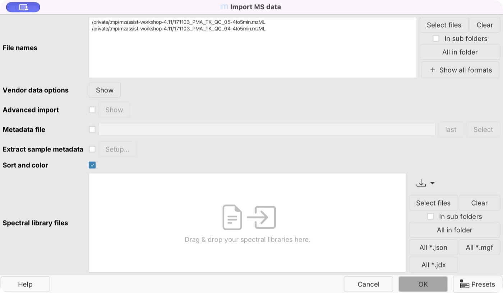
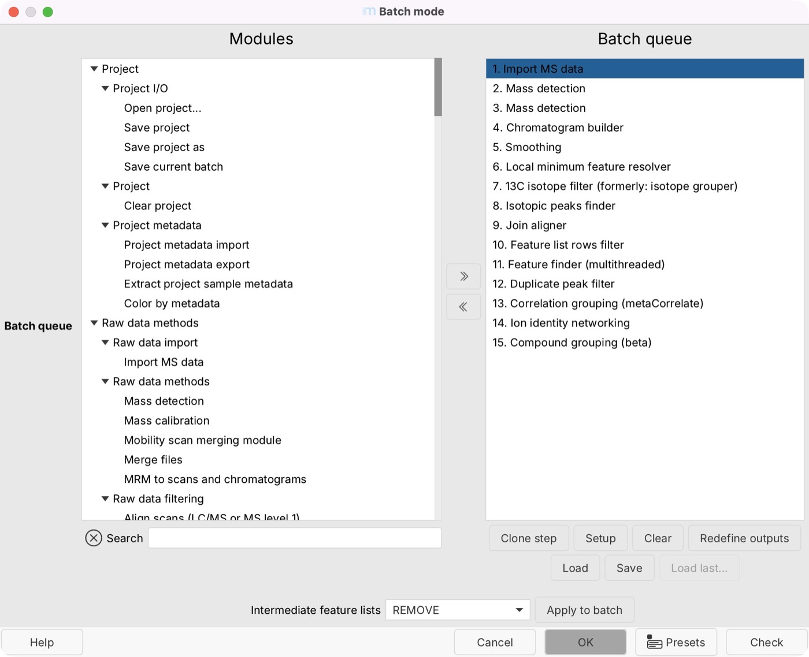
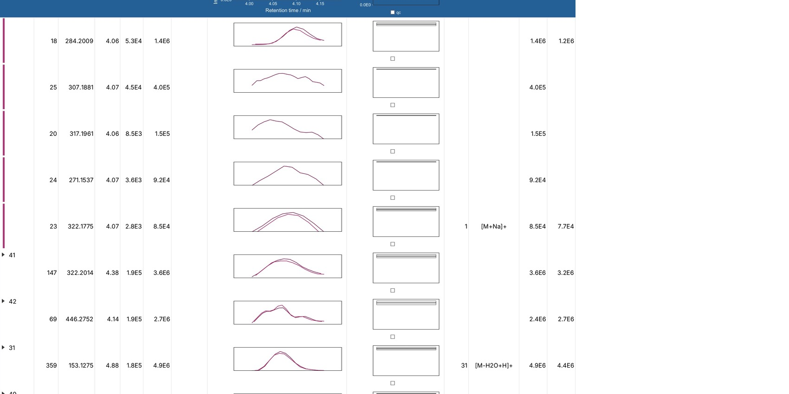
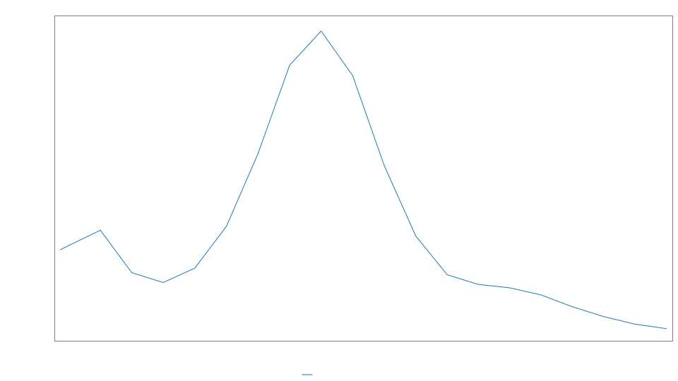
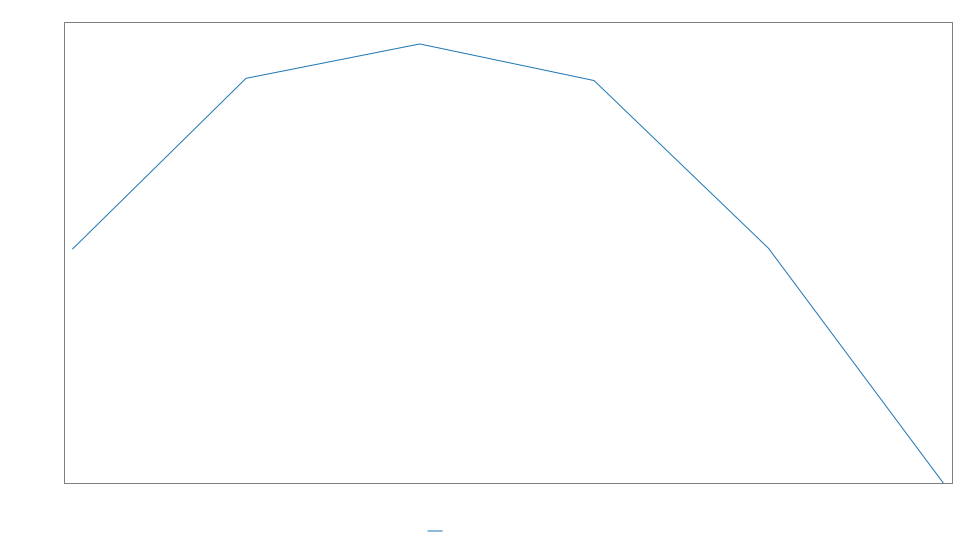

# Process your first dataset with mzassist

This walkthrough uses two small, public LC-MS/MS workshop files to practice importing data,
reviewing a method, processing, inspecting features, and saving your work. Complete
[Set up mzassist](mzassist-setup.md) first.

The processing example below was run with mzmine **4.11.0** on macOS with Apple Silicon.
The numerical settings are a worked example for these files, not a general LC-MS method.

## Download the example files

Download these two QC extracts from the mzmine project's public workshop test dataset and place
them together in a new folder:

- [QC 04 — 171103_PMA_TK_QC_04-4to5min.mzML](https://raw.githubusercontent.com/mzmine/mzmine/b440bccf29c1cead1fb46d6003f859ac1416edc0/mzmine-community/src/test/resources/rawdatafiles/integration_tests/workshop_dataset/171103_PMA_TK_QC_04-4to5min.mzML)
- [QC 05 — 171103_PMA_TK_QC_05-4to5min.mzML](https://raw.githubusercontent.com/mzmine/mzmine/b440bccf29c1cead1fb46d6003f859ac1416edc0/mzmine-community/src/test/resources/rawdatafiles/integration_tests/workshop_dataset/171103_PMA_TK_QC_05-4to5min.mzML)

Each file is about 4 MB and contains only the 4–5 minute portion of a positive-mode Q Exactive
LC-MS/MS acquisition. These are two QC injections, not treatment and control groups. Use them to
learn the workflow; they cannot establish batch-wide drift, a biological difference, or the quality
of the complete chromatographic run.

## Import in mzmine

Save any existing project before starting a separate practice project. In your assistant chat, ask:

> Help me process the two public workshop QC extracts into an aligned feature table. Let me select
> the folder in mzmine, and stop for my review before running the processing batch.

Choose the example folder in the mzmine file chooser. Check that only the two mzML files are
selected, then complete the import. Do not import the repository's test metadata or batch files;
those serve separate automated tests.

**Check in mzmine:** two raw data files should be loaded. Open a raw-data view and check that the
chromatographic data cover approximately 4–5 minutes. Using the native chooser keeps your local
folder path out of chat.

*Check the two selected files before importing. Your folder location will differ.*

If the assistant requests sample metadata and acquisition-header information, review the sharing
choice before continuing. The imported project contains QC roles and acquisition dates. Sample
roles can come from filename-based assignment, so confirm them against the experiment. The header names
the instrument as **Q Exactive**, but its analyzer text says **FT-ICR**. For this example, select
**Orbitrap**, the analyzer used by the [Q Exactive instrument family](https://www.thermofisher.com/us/en/home/industrial/mass-spectrometry/liquid-chromatography-mass-spectrometry-lc-ms/lc-ms-systems/orbitrap-lc-ms/q-exactive-orbitrap-mass-spectrometers.html).
File-header text can contain mistakes; do not change the instrument choice solely to match that field.

## Prepare a simple method

Tell the assistant:

> These are positive-mode LC-MS/MS QC extracts from a Q Exactive, without ion mobility. Use a DDA
> feature-detection and alignment workflow. Keep the result in mzmine. For this practice run, omit
> library matching, lipid and formula annotation, spectral networking, normalization, and external
> exports. Explain the standard grouping steps that remain in the generated batch.

This keeps the first run focused on finding and aligning chromatographic features. Review the
proposal in chat or open the processing wizard for a closer look. Check:

- The two selected files, positive polarity, and no ion mobility.
- A mass-spectrometer preset appropriate for Q Exactive data and the DDA workflow.
- A retention-time selection that includes the supplied 4–5 minute segment.
- Peak-width, noise, minimum-height, and alignment settings suitable for the visible signals.
- No comparison groups or filters requiring study samples that are absent from this QC-only example.

Ask for parameter estimates using both selected files, then inspect the changes. In the verified
4.11 run, estimation changed the sample-introduction preset from **HPLC** to **UHPLC** and applied
these values:

| Setting | Applied value in this example |
| --- | --- |
| Retention-time interval | 4–5 min |
| Approximate feature FWHM | 0.03 min |
| Minimum consecutive scans | 5 |
| Minimum feature height | 74,000 a.u. |
| Noise detector | Factor of lowest signal: MS1 = 5; MS2 = 2 |
| Scan-to-scan m/z tolerance | 0.003 m/z or 7 ppm |
| Intra-sample m/z tolerance | 0.0015 m/z or 3 ppm |
| Alignment m/z tolerance | 0.0005 m/z or 2 ppm |
| Intra-sample / alignment RT tolerance | 0.04 / 0.01 min |
| Resolver chromatographic threshold / top-to-edge ratio | 85% / 1.7 |

Use the values read back from the wizard: estimated values may be rounded when applied.
Noise factors and the two resolver settings above are starting rules, not independent noise or
peak-quality measurements. Retention-time correction retained its existing **off** setting because
two files did not provide enough evidence for the estimator to assess it; this does not establish
that correction would be unnecessary in a complete study.

The cropped segment does not represent a complete run. Do not use it to infer a full-run gradient
or copy its settings unchanged to another dataset. Optimization needs at least three files and is
outside this two-file example. See [Build and improve a method](mzassist-methods.md) for those steps
on a suitable dataset.

## Review and run

Ask the assistant to summarize the final method and files. Confirm that the output is a feature
table kept in mzmine, then authorize processing when the summary is correct.

In mzmine 4.11, this method produces the 15-step batch below. The standard DDA workflow retains
**correlation grouping**, **ion identity networking**, and **compound grouping** even when
**Apply spectral networking (FBMN/IIMN)** is off. These group related ion signals; they do not
establish compound identity. The disabled spectral-networking option controls a separate stage
that compares MS/MS spectra.

*Read the generated batch as well as the wizard switches. The isotope-processing steps also remain;
they are separate from the optional filter that requires a carbon isotope pattern.*

Follow progress in **mzassist → Agent activity** or chat. Wait for the processing job to finish
before submitting another request. If it fails, inspect the reported step and existing outputs
before rerunning; [Troubleshooting](mzassist-troubleshooting.md) explains common cases.

## Inspect the result

**Expected output:** an aligned feature table containing measurements from the two QC extracts.
The verified run above completed all 15 steps and produced **399 rows** in one table with both
files. Your count can differ if settings, input files or software versions differ; a large feature
count alone is not a quality criterion.

The table may open in **Compounds** mode. In this example its header shows **105 compound rows;
399 total rows**. Compound rows organize related ion features; they are not 105 confirmed chemical
identifications. Use the selector at the bottom to switch from **Compounds** to **All feature rows**
for the individual-feature view.

Ask:

> Open the final aligned table in mzmine. Help me inspect a strong feature detected in both files
> and a weaker feature. Explain what to check in their chromatograms.

You can inspect the table entirely in mzmine. If the assistant needs measurements or plots to
answer, inspect and approve the [result-sharing request](mzassist-data-sharing.md) first.
Check peak boundaries, shape, alignment between the two injections, and available MS/MS evidence.
No library matching was requested, so an unannotated feature is not a processing failure.

### Two features to inspect

These examples come from the verified run. If row IDs differ in your run, find the corresponding
m/z and retention time instead.

| Example | What mzmine measured | What to inspect |
| --- | --- | --- |
| Stronger feature: row 22, m/z 300.1959, approximately 4.07 min | Detected in both files; heights approximately 3.69 × 10⁶ and 3.21 × 10⁶ a.u.; two associated MS/MS scans per file | Compare the two peak shapes and apex positions. Inspect the early shoulder and integration start near the cropped boundary. An assigned `[M+H]+` ion type does not identify the compound. |
| Weaker feature: row 1, m/z 503.2754, approximately 4.02 min | Detected in QC 05 at approximately 94,741 a.u.; no measured feature in QC 04; no associated MS/MS | Inspect the six-point processed trace and its position close to the 4-minute crop boundary. A missing measurement is not zero concentration or proof of absence. |

{ style="background: #111;" }

*Native mzmine capture of the processed feature trace for the stronger example. The trace contains
smoothing and selected feature boundaries; compare it with the extracted raw-data chromatogram
when assessing those boundaries.*

{ style="background: #111;" }

*Native capture of the weaker example. The two plots use different intensity scales.*

Do not turn the two QC injections into independent biological groups or use this example for a
carryover analysis: it contains no complete injection sequence or blanks.

## Save and continue

1. Save the practice project in mzmine.
2. Save the reviewed wizard preset and the batch actually used for the resulting table.
3. Reopen the saved project and check that its two raw files, feature table, and applied methods are
   present. In the verified example, the reopened table retained 399 rows and all 15 methods.
4. If you export a selection, check that export finished and open the output files.

Choose **Standalone (large/flexible)** when saving this small practice project if you want its raw
files included. In **Batch mode**, use **Save** to preserve the 15-step batch; close the editor with
**Cancel** afterward if you are only saving it, so you do not start another processing run.

Follow [Save and reproduce your work](mzassist-saving.md). With your own study data, add the real
sample metadata, review the annotation strategy, and choose an appropriate
[results analysis](scientific-analysis.md).

{{ git_page_authors }}
