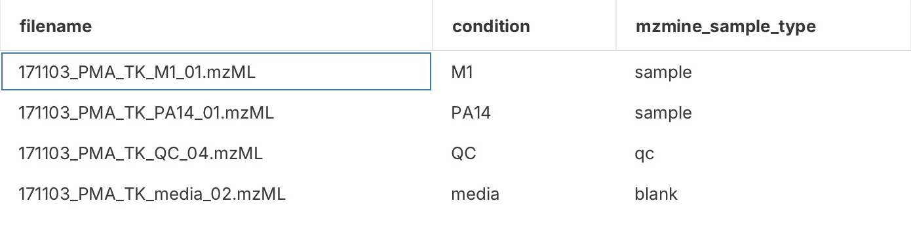
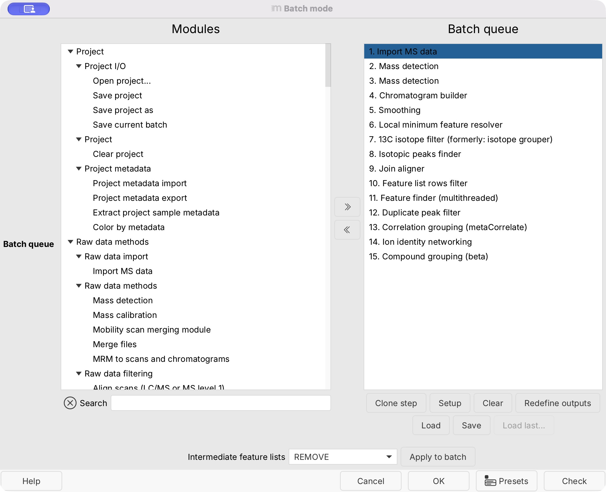
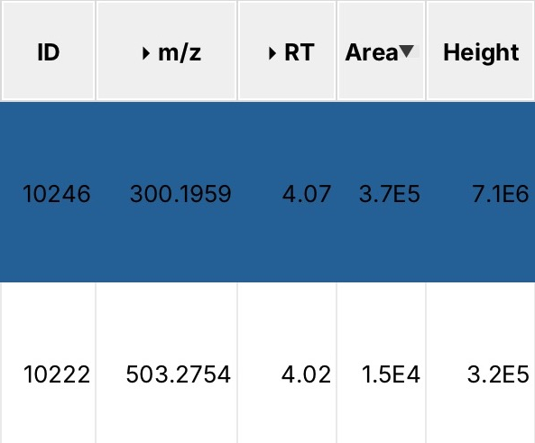
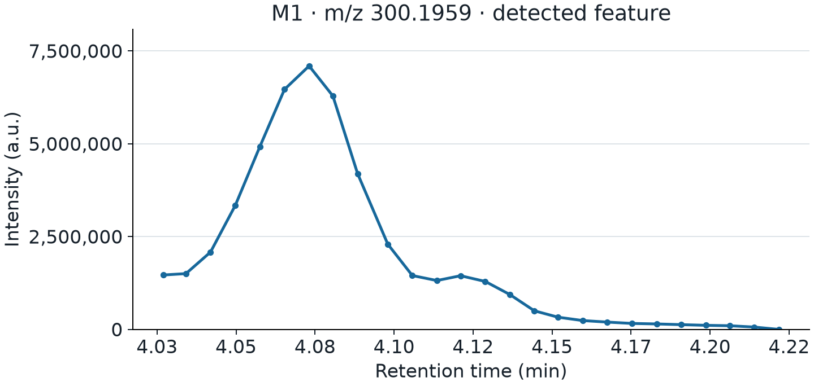
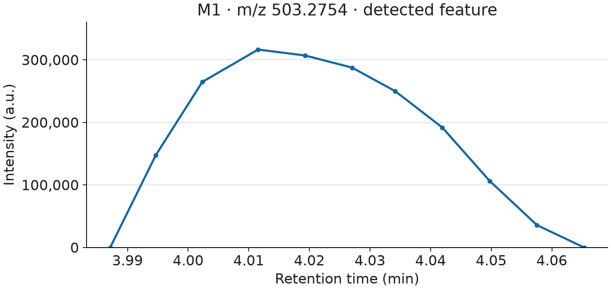
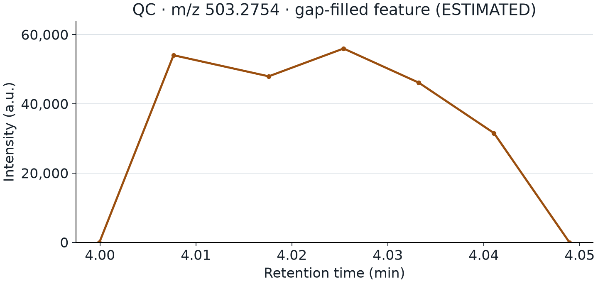

# Process your first dataset {#process-your-first-dataset-with-mzassist}

Use a small public LC-MS/MS workshop dataset to practice importing data, reviewing a method,
processing, inspecting features, and saving your work. Complete [Set up mzassist](mzassist-setup.md)
and read [Data sharing and agent controls](mzassist-data-sharing.md) first.
You can follow the analysis in chat; the manual routes below are optional ways to inspect
what mzmine is doing.

The worked example was run with mzmine **4.11.0** on macOS with Apple Silicon. Its settings and
results belong to these files, rather than a general LC-MS method.

## Download the example files

Use [MassIVE dataset MSV000089249](https://doi.org/10.25345/C54B2X835),
**GNPS_PA_M1_PA14_dataset_workshop_material**, deposited by Pierre-Marie Allard's group.
The dataset contains measurements from *Pseudomonas aeruginosa* M1 and PA14, with QC and media
samples. It is public and explicitly released under
**CC0 1.0 Universal** on its
[dataset page](https://massive.ucsd.edu/ProteoSAFe/dataset.jsp?task=58559b6eb6574233967ca1947ffb4029).
No account is needed for these downloads.

Save the following four files and the metadata file together in a new folder. They total about
**139 MB**. These are the submitter's full-run mzML files from **peak/converted_data_mzML**;
the repository also contains larger converted copies with the same names in a different collection.

| File | Use in this exercise | Download size |
| --- | --- | --- |
| [171103_PMA_TK_M1_01.mzML](https://massive.ucsd.edu/ProteoSAFe/DownloadResultFile?file=f.MSV000089249%2Fpeak%2Fconverted_data_mzML%2F171103_PMA_TK_M1_01.mzML&forceDownload=true) | M1 sample | 34.3 MB |
| [171103_PMA_TK_PA14_01.mzML](https://massive.ucsd.edu/ProteoSAFe/DownloadResultFile?file=f.MSV000089249%2Fpeak%2Fconverted_data_mzML%2F171103_PMA_TK_PA14_01.mzML&forceDownload=true) | PA14 sample | 34.5 MB |
| [171103_PMA_TK_QC_04.mzML](https://massive.ucsd.edu/ProteoSAFe/DownloadResultFile?file=f.MSV000089249%2Fpeak%2Fconverted_data_mzML%2F171103_PMA_TK_QC_04.mzML&forceDownload=true) | QC injection | 34.4 MB |
| [171103_PMA_TK_media_02.mzML](https://massive.ucsd.edu/ProteoSAFe/DownloadResultFile?file=f.MSV000089249%2Fpeak%2Fconverted_data_mzML%2F171103_PMA_TK_media_02.mzML&forceDownload=true) | Media control | 35.4 MB |
| [metadata_PA.tsv](https://massive.ucsd.edu/ProteoSAFe/DownloadResultFile?file=f.MSV000089249%2Fmetadata%2Fmetadata_PA.tsv&forceDownload=true) | Condition and species labels | 1.1 kB |

Alternatively, open the [MassIVE file browser](https://massive.ucsd.edu/ProteoSAFe/dataset_files.jsp?task=58559b6eb6574233967ca1947ffb4029),
select the **peak** collection, and download the four names above from **converted_data_mzML**.
Select **metadata** for `metadata_PA.tsv`. You do not need the vendor raw files, the larger
`ccms_peak` copies, or the complete dataset for this walkthrough.

The subset gives you two sample conditions and two controls to inspect.
One injection per condition and one QC are insufficient for a replicated study
comparison or a QC precision assessment. The media control is not a solvent blank, and this subset
is not a complete injection sequence for assessing carryover.

## Import in mzmine

Save any existing project before starting a separate practice project. In chat, ask:

> Help me process the four public MassIVE workshop files into an aligned feature table. Let me
> select the folder in mzmine. Import its metadata_PA.tsv file too, and stop for my review before
> running the processing batch.

Choose the folder in mzmine's file chooser. mzassist checks the four selected mzML files and the
metadata file before completing the import. If it opens an import review for you, check those
selections there. Using the native chooser keeps your local folder path out of chat.

If mzassist requests sample metadata and acquisition-header information, review the
[sharing request](mzassist-data-sharing.md#review-a-sharing-request). Then ask:

> Show me the imported conditions and sample roles. Explain any differences between the supplied
> metadata and labels inferred from filenames.

The supplied metadata identifies **M1**, **PA14**, **QC**, and **media**. mzmine also extracts
acquisition dates and can infer analytical roles from filenames. In this run it labelled the media
file as **blank**; the supplied condition remains **media**. Keep that distinction when interpreting
signals. Optional manual inspection is under **Project → Sample metadata**.

*The repository metadata covers the larger dataset; mzmine matches the rows for the four imported files.*

## Identify the acquisition

Before giving mzassist the expected properties, ask:

> What kind of data did we import? Inspect the polarity, instrument and analyzer information,
> acquisition mode, ion mobility and retention-time range. Explain which properties the imported
> files support, and flag missing or conflicting information. Check the linked MassIVE acquisition
> record where the file headers are unclear.

Compare the answer with the check below before accepting the method. This example contains a
header discrepancy, so the acquisition record is needed to resolve the instrument choice.

??? note "Check: expected dataset properties"

    - **Separation and polarity:** positive-mode UHPLC–MS/MS.
    - **Instrument/analyzer:** the [MassIVE acquisition record](https://massive.ucsd.edu/ProteoSAFe/dataset.jsp?task=58559b6eb6574233967ca1947ffb4029)
      identifies a **Q Exactive Focus**, so choose **Orbitrap**. The mzML analyzer text reports
      **FT-ICR**, which conflicts with that record. An answer based only on that header needs correction.
    - **Acquisition mode:** data-dependent MS/MS (**DDA**).
    - **Ion mobility:** none in these files.
    - **Retention-time range:** approximately **0–9 minutes** before parameter estimation.

    Ask mzassist to explain and resolve any disagreement before it prepares the method.

## Prepare a simple method

Tell mzassist:

> Use the acquisition properties we just reviewed. Prepare feature detection and alignment,
> estimate settings from all four files, and keep the result in mzmine. For this
> exercise, omit library matching, lipid and formula annotation, spectral networking, normalization,
> QC precision filtering, and external exports. Explain the remaining grouping steps and show the
> final method before processing.

Review the proposed method in chat. It should use all four files and the acquisition properties
you checked above. The initial RT interval covers the full acquisition; estimation narrows it to
the detected separation range. The verified run applied these values:

| Setting | Applied value in this example |
| --- | --- |
| Retention-time interval | 0.20–8.77 min |
| Approximate feature FWHM | 0.02 min |
| Minimum consecutive scans | 4 |
| Minimum feature height | 140,000 a.u. |
| Noise detector | Factor of lowest signal: MS1 = 5; MS2 = 2 |
| Scan-to-scan m/z tolerance | 0.003 m/z or 7 ppm |
| Intra-sample m/z tolerance | 0.0015 m/z or 3 ppm |
| Alignment m/z tolerance | 0.001 m/z or 5 ppm |
| Intra-sample / alignment RT tolerance | 0.04 / 0.06 min |
| Resolver chromatographic threshold / top-to-edge ratio | 85% / 1.7 |

The displayed values reflect rounding when estimates are applied. Noise factors and the two resolver
settings above are starting rules, rather than independent noise or peak-quality measurements.
Retention-time correction was off in this method. Optimization is outside this first exercise;
see [Build and improve a method](mzassist-methods.md) for further refinement.

Optional manual inspection: ask mzassist to open the current method in mzmine.
**mzwizard → Processing wizard** can open a new wizard tab, so check which method it displays.
You do not need to enter the values above by hand when following the mzassist route.

## Review and run

Ask mzassist for a final summary of the files, settings, generated batch, and outputs. When it is
correct, reply **“Run this batch.”** The result stays in mzmine; this method has no export destinations.

In mzmine 4.11, this produces a 15-step batch: data import, two mass-detection steps (MS1 and MS2),
chromatogram building, smoothing, peak resolution, two isotope-processing steps, alignment,
row filtering, gap filling, duplicate removal, correlation grouping, ion identity networking,
and compound grouping. The last grouping steps remain even with **Apply spectral
networking (FBMN/IIMN)** off: they group related ion signals, whereas that optional spectral-networking
stage compares MS/MS spectra.

*The batch editor shows the ordered processing steps. Opening it for inspection or saving does not
start processing; **OK** starts the batch, while **Cancel** closes the editor.*

Follow progress in chat, or open **mzassist → Agent activity**. If a job fails, ask mzassist to
explain the failed step and existing outputs before deciding what to rerun. See
[Troubleshooting](mzassist-troubleshooting.md).

## Inspect the result

**Expected output:** one aligned feature table containing measurements from all four files.
The verified run completed all 15 steps and produced **12,337 feature rows**. Your count can differ
with settings or software versions; a large feature count alone is not a quality criterion.

Ask mzassist:

> Open the final aligned table in mzmine. Help me inspect a strong feature across the four files
> and a weaker feature. Show their chromatograms and explain what the media control contributes
> to the interpretation.

If mzassist needs measurements or plots to answer, review the separate
[result-sharing request](mzassist-data-sharing.md#review-a-sharing-request). You can also keep the
data private and inspect the table in mzmine yourself.

The table may open in **Compounds** mode, which groups related ion features.
Ask mzassist to show the individual features, or use the
selector at the bottom of the open table to switch to **All feature rows**.

### Two features to explore

The example below uses two rows from the verified run. Ask mzassist to find them by **m/z and
retention time** if your row IDs differ:

> Show the feature near m/z 300.1959 at 4.07 minutes and the one near m/z 503.2754 at 4.02 minutes.
> Compare their peak shapes, measurements and detection status across the four files. Explain any
> gap-filled measurements and whether MS/MS is available.

*Detail of rows 10246 and 10222. The area and height columns here summarize each row; measurements
for the individual samples are listed below. Click the image to open the full table screenshot.
The complete result contains 12,337 feature rows grouped into 4,311 compound rows.*

| Feature in this run | M1 peak height | PA14 peak height | QC peak height | Media |
| --- | --- | --- | --- | --- |
| m/z 300.1959, RT 4.07 min (row 10246) | 7.10 million, detected | 2.64 million, detected | 3.69 million, detected | No reported measurement |
| m/z 503.2754, RT 4.02 min (row 10222) | 316,507, detected | No reported measurement | 55,984, **ESTIMATED** | No reported measurement |

*Peak heights are in arbitrary intensity units. **ESTIMATED** identifies a measurement recovered
during gap filling, rather than a peak independently found in the initial detection step.*

*The stronger feature in M1, with an apex near 4.07 min. The early boundary, shoulder and tail are
useful points to discuss with mzassist when assessing the integration. This row has MS/MS scans
in M1, PA14 and QC.*

*The weaker feature is detected in M1. No MS/MS scans were assigned to this row.*

*The same row in QC is marked **ESTIMATED**. Its height is below the initial 140,000-unit detection
threshold; gap filling recovered a measurement at the expected location. Inspecting this trace
helps you judge whether that estimate is useful for your question.*

These plots show all points from mzmine's **processed feature traces**, redrawn on a light background
for readability. They include the effects of smoothing and the selected peak boundaries;
they are not full raw extracted-ion chromatograms. The plots use different intensity
scales; use the values in the table to compare signal sizes. For a wider view of a boundary or nearby
peak, ask mzassist to show the raw extracted-ion chromatogram around that retention time.

When reviewing a feature with mzassist, consider:

- Do the chromatographic peak boundaries and shape support the reported measurement?
- Do corresponding peaks align across the files where the feature was detected?
- Is a similar signal present in the media control, and what does that imply for this sample?
- Is MS/MS available, and does it support an annotation or only a feature for further investigation?

No library matching was requested, so an unannotated feature is expected. For the distinction between
features, annotations and confirmed identities, see [Interpreting results](mzassist-results.md#interpreting-results).

## Save and continue

Ask mzassist to help preserve the project and the method actually used. To save the project manually,
choose **Project → Save project as**, select a new filename, and choose **Standalone (large/flexible)**
to include the four raw data files. Save the wizard preset separately if you want to reuse its settings.

Recovering the completed table's processing batch replaces the current batch queue. If you need to
keep the existing queue, open **Project → Batch mode** and click **Save** first. Then open
**Feature lists**, right-click the completed table, choose **Show feature list summary**, and click
**Open in batch queue**. Review any
warning about methods that cannot be batch steps, then confirm **Overwriting batch?**. Check the
restored steps and click **Save**. After saving the `.mzbatch` file, close that editor with **Cancel**
to avoid starting another run.

Reopen the project through **Project → Open project** and ask mzassist to check its four raw files,
feature table and recorded methods. Follow [Save and reproduce your work](mzassist-saving.md) for
the differences between projects, presets, batches and exported results.

In the verified example, the standalone project reopened with all four raw files, the 12,337-row
table and 15 recorded methods. The saved wizard preset reloaded with unchanged settings, and the
saved batch contained all 15 processing steps.

With your own study data, add the real sample information, review the annotation strategy, and
choose an appropriate [scientific analysis](scientific-analysis.md).

{{ git_page_authors }}
