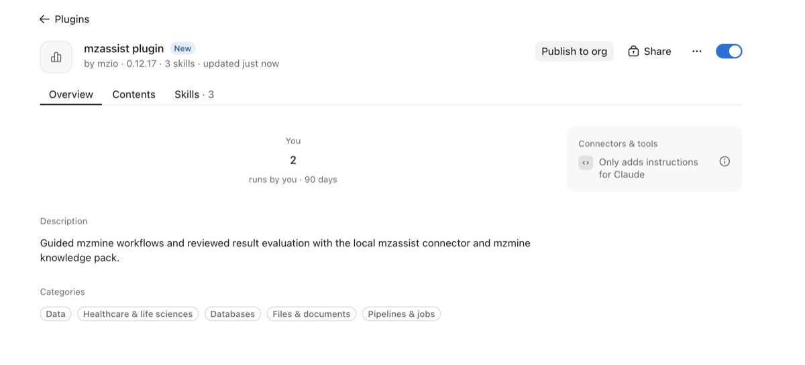

# Set up mzassist

:material-menu-open: **mzassist → Set up mzassist**

mzassist connects mzmine to Claude Desktop or a supported OpenAI desktop application on the same
computer. After installing and opening mzmine, choose **mzassist → Set up mzassist** from its menu
to install the connection and workflow plugin.

## Before you begin

- Download the installer or portable package for your operating system from
  [mzmine GitHub Releases](https://github.com/mzmine/mzmine/releases/latest).
  Follow the [mzmine installation guide](../getting_started.md#install-update).
- Sign in to mzmine with an Academic, Pro, or Pro trial account. See
  [Users management](../services/users.md) if the mzassist menu is missing.
- Install the desktop assistant you intend to use. Its account, subscription, organization policy,
  and support for local plugins are separate from your mzmine account.
- Keep mzmine and the assistant running on the same computer. A browser-only chat does not gain
  access to mzmine merely by signing in to the same account.

The setup files included with mzmine are specific to the operating system and processor.
Use the files offered by your installation. If setup reports that they are unavailable, follow
[Missing setup files](mzassist-troubleshooting.md#missing-setup-files); installing a package for a
different platform will not resolve that problem.

## Claude Desktop

1. In mzmine, open **mzassist → Set up mzassist** and select **Claude Desktop**.
2. On macOS or Windows, click **Open connector installer** and complete the installation in Claude
   Desktop. On Linux, click **Show connector** to reveal the `.mcpb` file, then import it manually
   using the settings below. This installs the connection to mzmine.
   If you need to locate the package, click
   **Show plugin ZIP** in the same mzmine setup window. The folder it opens contains both the
   plugin ZIP and the connector installer (`.mcpb`). In **Claude Settings → Desktop app**, click
   **Manage** beside **Extensions**, then choose **Advanced settings → Install extension** and
   select that `.mcpb` file.
   Older Claude versions may have an **Extensions** item directly in Settings.
3. Back in mzmine, click **Show plugin ZIP**. In Claude, open
   **Customize → Plugins → + Add → Upload plugin**, select `mzassist-plugin.zip` without extracting
   it, and click **Upload**. When updating, choose **Replace** for the existing mzassist plugin.
4. Check that the **mzassist** desktop extension and **mzassist plugin** are both enabled and
   have the matching version. Restart Claude Desktop and start a new chat.

*The workflow plugin is a separate installation from the desktop connector. This example shows
Claude Desktop 4.23118.0 with the plugin supplied in mzmine 4.11.*

Claude's menu labels can change between versions. Use the help link in the mzmine setup screen or
[Claude's plugin instructions](https://support.claude.com/en/articles/13837440-use-plugins-in-claude)
if the upload option has moved.

## ChatGPT desktop / Work / Codex {#chatgpt-desktop-or-codex}

[Work](https://learn.chatgpt.com/docs/get-started-with-work) is ChatGPT's mode for completing tasks
with files and tools. For mzassist, use Work or Codex in the desktop app on the computer running mzmine.

1. Open **mzassist → Set up mzassist** and choose **ChatGPT desktop / Work / Codex**.
2. Click **Prepare plugin**. This makes the included package available to the assistant's
   **Personal** plugin collection; it does not complete installation inside the assistant.
3. Restart the assistant. Open **Plugins → Personal**, open **mzassist plugin**, and use **+**
   to add it (or the update control if it is already installed).
4. Start a new local Work or Codex chat with the plugin enabled.

This package includes the connection and workflow instructions together. If your assistant does
not offer local plugin installation, check its version and your organization's settings before
continuing. Follow the setup instructions for the application you are actually using.
See also [OpenAI's plugin installation guide](https://learn.chatgpt.com/docs/plugins).

## Check the connection

The local connection is on by default. In mzmine, open **mzassist → Agent activity**; if it was
disconnected, click **Enable local connection** in that tab.
In a new assistant chat, ask:

> Connect to mzmine and tell me which instance you connected to. Do not start an analysis yet.

If more than one mzmine window is running, choose the intended instance. A successful connection
lets the assistant read the available tasks. You do not need to share sample metadata or results
just to check the connection.

Next, read [Data sharing and agent controls](mzassist-data-sharing.md). Then follow
[Process your first dataset](mzassist-first-analysis.md), or
[Explore and evaluate results](mzassist-results.md) for an existing project.

## Update mzassist

Install the newer mzmine release from
[GitHub Releases](https://github.com/mzmine/mzmine/releases/latest), then open
**mzassist → Set up mzassist** in mzmine and update the included packages in your desktop chat app.
Keep the connector and plugin from the same release.
For Claude, update both the connector and the plugin. Restart the assistant and start a new chat
so it loads the updated tools and instructions.

If your project is already open, save it before updating. Check the connection again after the
update; an earlier sharing decision or workflow review may no longer apply.

{{ git_page_authors }}
