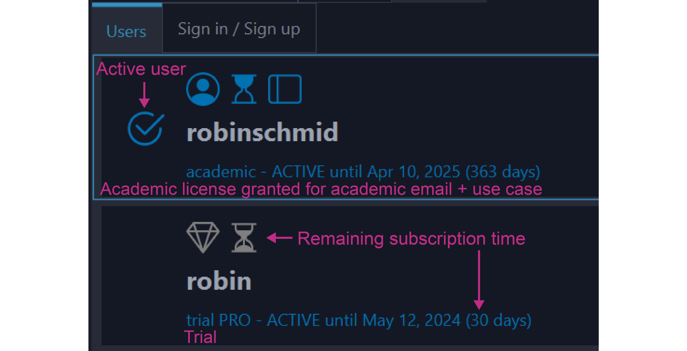
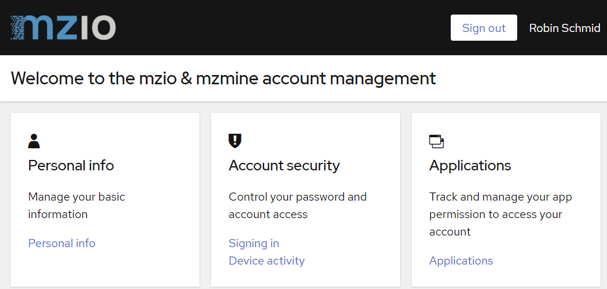
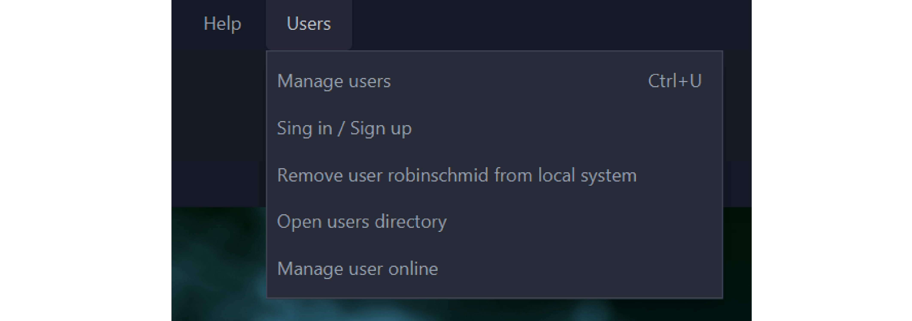
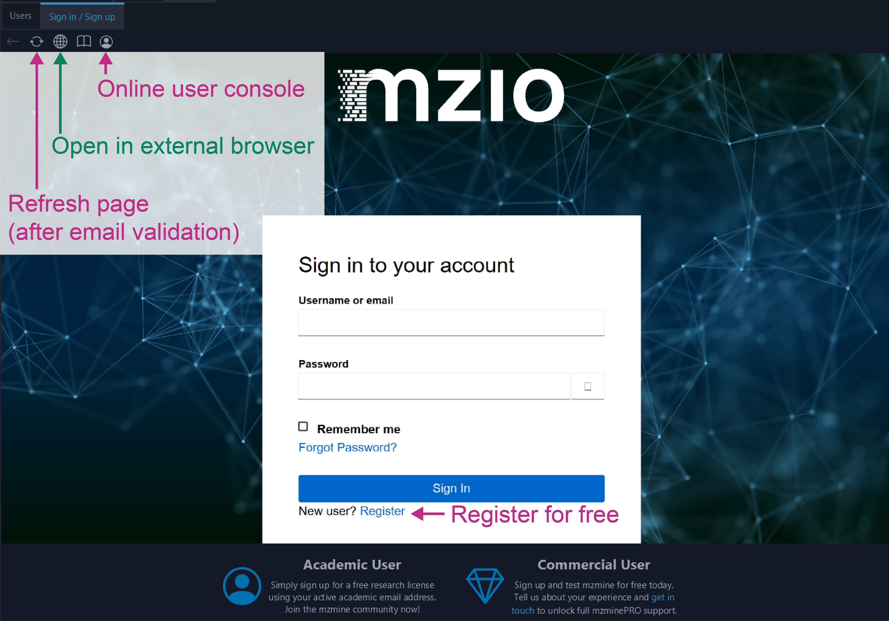
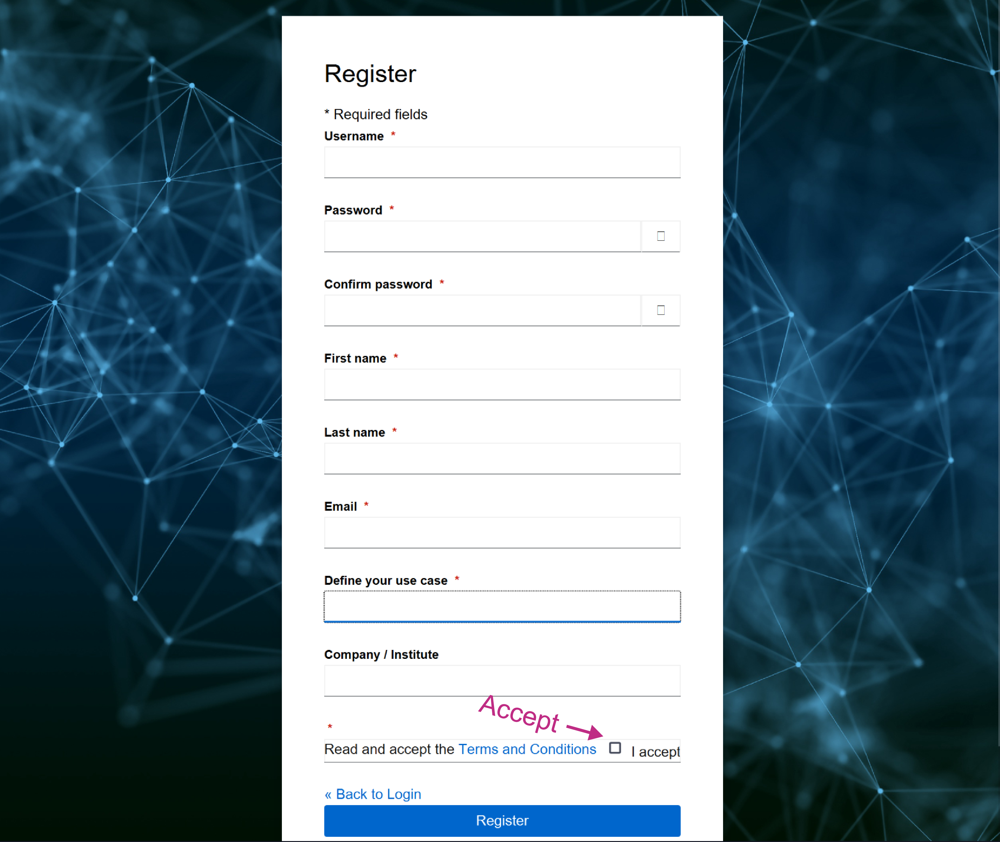
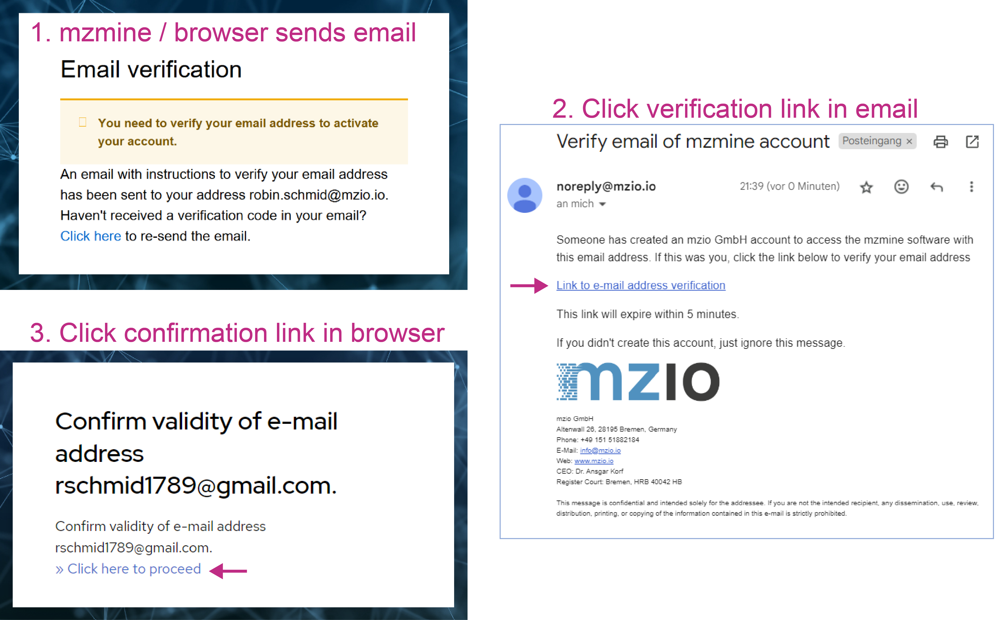
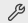

# Users management

## Sign up / Registration

Users can sign in into an existing account or sign up (register) a new free account within seconds.
The sign up is available directly in the mzmine **Users** menu (Manage users). If you experience any issues with the built-in
webview, click the external browser button and sign up online. Briefly, the user needs to provide few details
including:

- **Username**: Fixed identifier that cannot be changed
- **Define your use case**: The intended use of this user profile, either **commercial use** or *
  *non-profit academic use**
- **Email**: Either an academic or company email address. It is important to use an
  academic email address to gain a non-profit academic license.
- **Read and accept the [Terms and Conditions](https://mzio.io/general-terms-and-conditions/)**

After clicking the register button, a verification email is sent to the provided address. This can
take a few minutes.

1. Please open the email
2. Click the verification link that redirects to the user portal
3. Verify the email by **Click here to proceed** to verify your email
4. Return to mzmine and refresh the page (automatically done every 30 seconds)
5. Check your license status in mzmine. Every user will receive a 30-day trial license or a
   non-profit academic license. Please reach out if your academic institution still needs our
   automatic validation.



## License Pooling

MZmine uses a floating license pool for distributing licenses. A license can only be used by one mzmine Instance at a time.
While mzmine is running, the license is locked to the mzmine instance, after mzmine is closed the license is released again.
This requires an active internet connection, the license status is checked regularly.

### Licenses for Organizations

mzmine supports pooling of licenses across users in an organization, allowing for reuse of licenses . Please contact us directly for details.

## Offline use / Airplane Mode

If no internet access is available, a license can be removed from the license pool and converted for offline use for a specified time.
During this time, the license cannot be used by any other mzmine instance, so use this feature carefully.
A license can be converted to an offline License using two methods:

- Inside the **Users/User management** on the computer it will be used on (internet connection required)
- Be claimed from the [mzio user account console](https://auth.mzio.io/realms/mzio/account/)


## User account console - changing user details

Open the [mzio user account console](https://auth.mzio.io/realms/mzio/account/) and sign in with
your user credentials. Go to personal information to update any details. When changing the **email** the user
is automatically logged out. On the next sign in, the user will receive another verification email to validate email
address ownership.
Revalidation of the email also triggers a revalidation of the **non-profit academic license**.



### Changing password & adding Two-factor authentication

Within the account console, navigate to **Account security/Signing in** and update your password.
Two-factor authentication can be activated on the same page. Start the setup and follow the
instructions.
This requires a mobile authenticator app that will generate a one-time-password for each sign in.

## Reset password

On the sign in page in mzmine or in
the [user account console](https://auth.mzio.io/realms/mzio/account/) click on **Forgot Password**,
enter your username or email.
An email for resetting the password will be sent to the users email within a few minutes. Follow the
instruction by
clicking on the link and entering a new password.

## Sign up / Registration details

Open mzmine and navigate to **Users/Manage users**, alternatively click on the user icon on the
mzmine landing page.
If you have a user account sign in. Otherwise, click on **register**.





Fill in the registration form and provide all details including:

- **Username**: Fixed identifier that cannot be changed
- **Define your use case**: The intended use of this user profile, either **commercial use** or *
  *non-profit academic use**
- **Email**: Either an academic, company, or personal email address. It is important to use an
  academic email address to gain a non-profit academic license
- **Read and accept the [Terms and Conditions](https://mzio.io/general-terms-and-conditions/)**



After clicking the register button, a verification email is sent to the provided address. This can
take
a few minutes.



1. Please open the email
2. Click the verification link that redirects to the user portal
3. Verify the email by **Click here to proceed** to verify your email
4. Return to mzmine and refresh the page (automatically done every 30 seconds)
5. Check your license status in mzmine. Every user will receive a 30-day trial license or a
   non-profit academic license. Please reach out if your academic institution still needs our
   automatic validation.


## Command-line interface (CLI)

Using the command-line Users can be logged in via command-line arguments to run mzmine in batch mode.
See [CLI tools](../commandline_tool.md) for more information.

The most important commands on Windows are:
```
# login in browser
"C:\Program Files\mzmine\mzmine_console.exe" -login
```

## Alternative Sign in / Sign up

Alternatively users can register on the mzio.io
website [https://auth.mzio.io/realms/mzio/account](https://auth.mzio.io/realms/mzio/account/) by
clicking on the **Sign in** button in the top right corner.
Then follow the regular self-registration described above. Finally, users will need to sign in to
the mzmine software. If the sign in website does not load in mzmine, click
the .

## mzmine's educational non-profit program

During your registration in mzmine, you may enter an email address of your educational institution.
This will grant automatic access to our academic non-profit program if your institution is already
listed with us. If you receive a trial version, please reach out to us and provide any information
required to prove the educational non-profit status.

Each year, academic users will need to update their user profile, potentially changing to their
current institution and new email address, and to verify their email. This will renew your academic
license if your institution is still in our program. Otherwise, users are granted a trial version.


## Frequently asked questions (FAQ)

1. Why is the link to verify my email address missing?
    - Your email provider may remove links as a security measure. Please reach out to your
      postmaster or IT administrator with `info@mzio.io` in Cc to resolve this issue. Please provide
      the information that links are missing and that the domain mzio.io can be trusted.

2. Why am I not receiving any verification email?
    - Your email provider may falsely block the mzio.io domain. Please reach out to your postmaster
      or IT administrator with `info@mzio.io` in Cc to resolve this issue. Please provide the
      information that the domain mzio.io can be trusted.

3. The login page in mzmine is not loading, what can I do?
    - The poxy settings and alternative sign in page may open automatically or is available by
      clicking on the tool button  on the _Sign in/Sign up_ page.
    - Check your computers proxy settings and apply them on this page and press update proxy to
      retry.
    - Otherwise, try the alternative sign in by username and password. This requires an existing
      mzmine user that can also be registered on the website.

4. My academic account expires soon, how to renew my account?
    - Once the license is expired, on your next login you will need to update your user details and revalidate your academic email address. If successful this will grant another year in our academic non-profit program.
    - During your profile update, you will have the chance to change to your new institution and email address.
