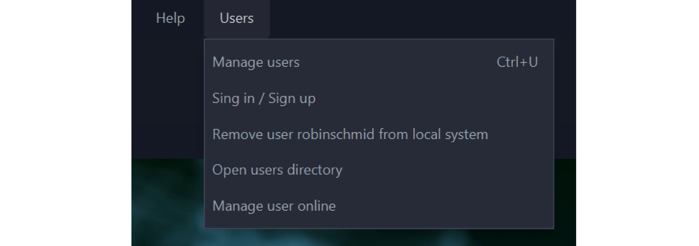
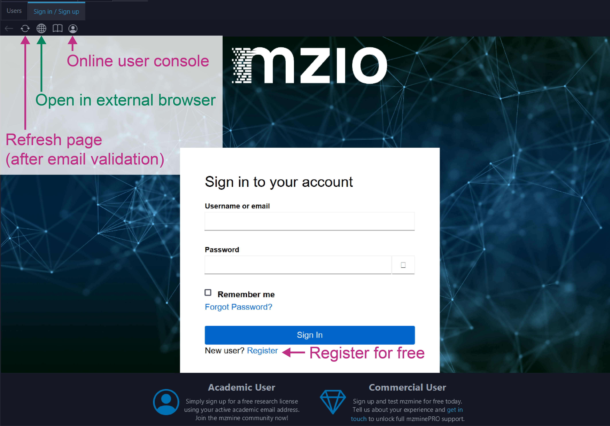
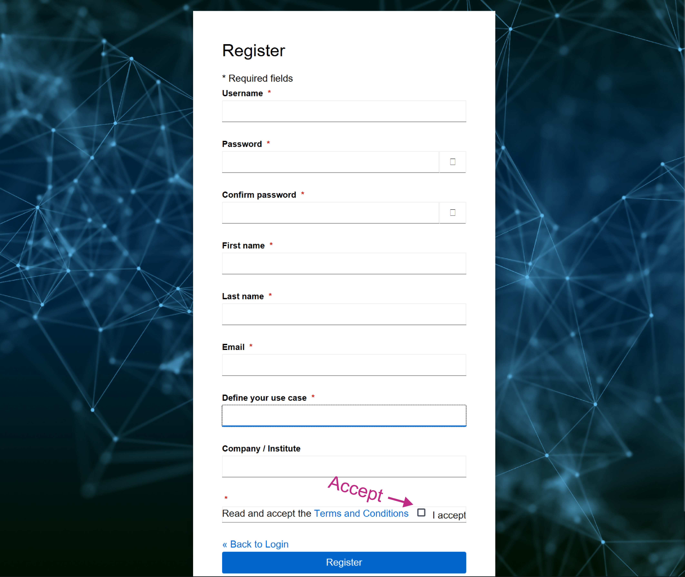
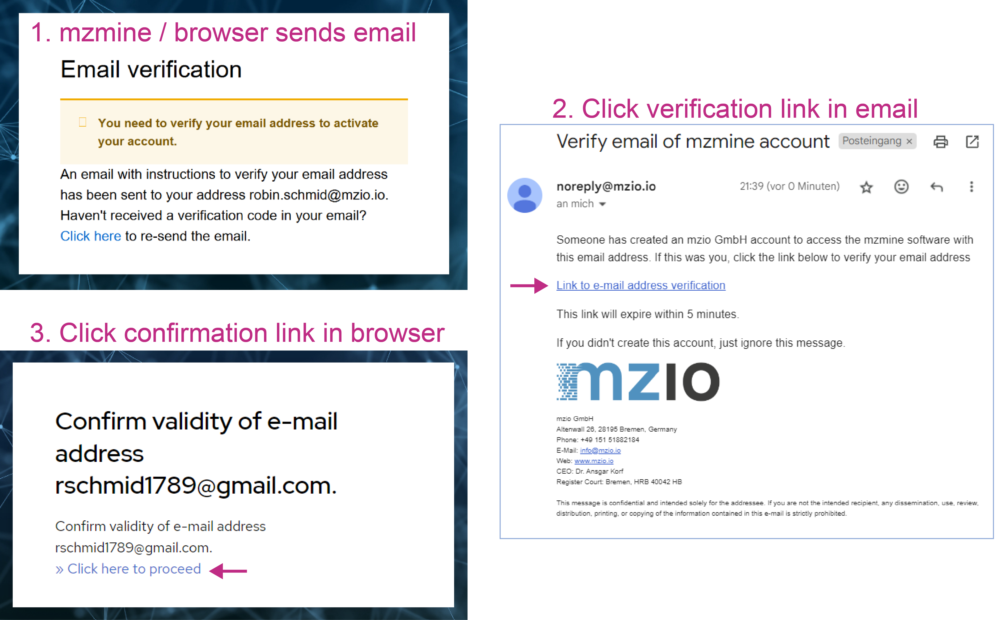
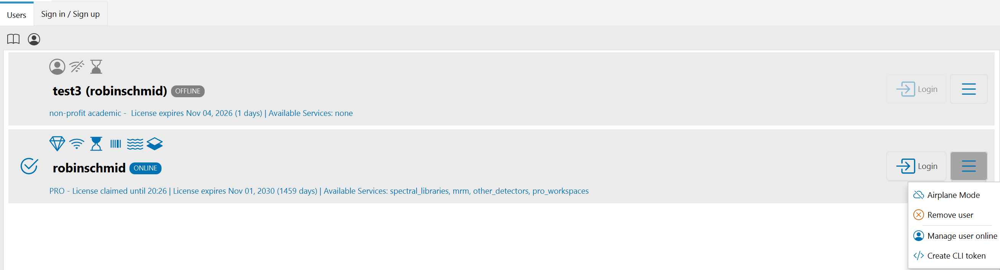
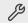
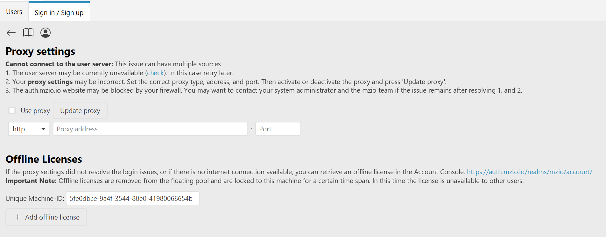
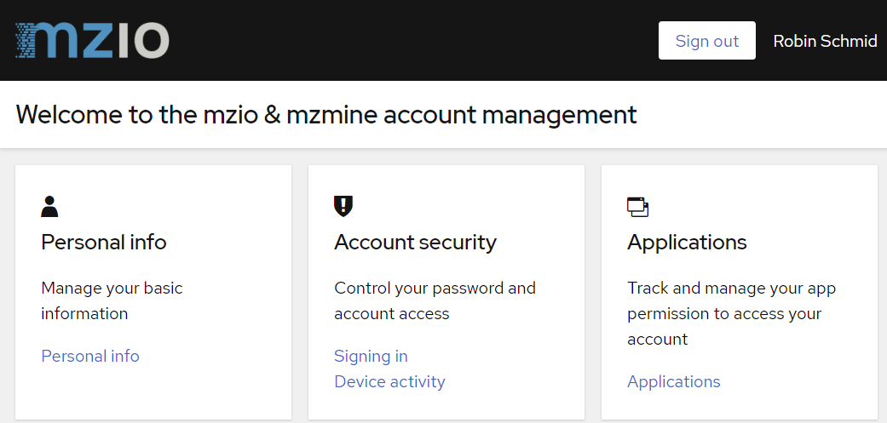
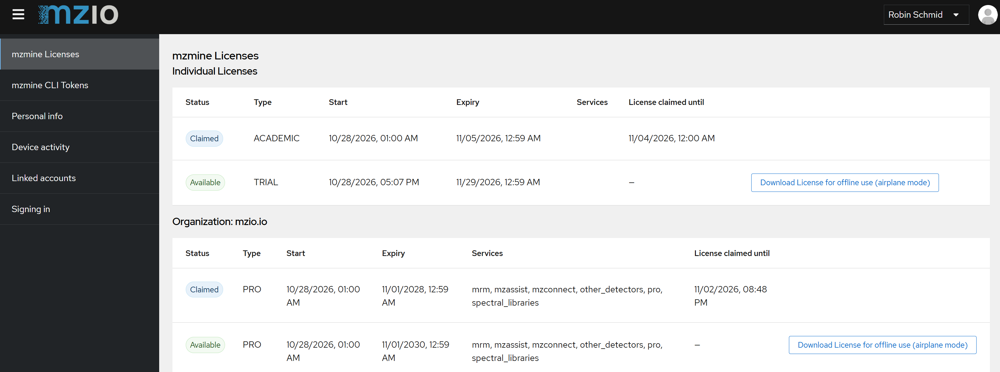
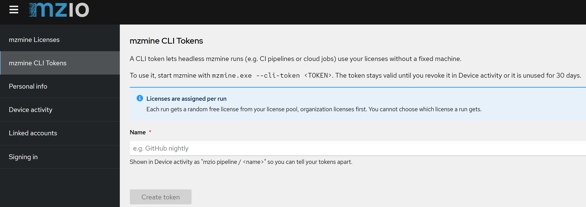

# Users management

mzmine is used with an mzio user account. The account holds your license, which mzmine claims while
you work and returns once you close mzmine or leave it unused for a longer time.

## Sign up / Registration

Users can sign in to an existing account or sign up (register) a new free account within seconds.
Open mzmine and navigate to **Users → Manage users**, alternatively click on the user icon on the
mzmine landing page. If you have a user account, sign in. Otherwise, click on **register**.
If you experience any issues with the built-in webview, click the external browser button and sign
up online. Or go directly to the mzio
[user management website](https://auth.mzio.io/realms/mzio/account/).





Fill in the registration form and provide all details including:

- **Username**: Fixed identifier that cannot be changed
- **Define your use case**: The intended use of this user profile, either **commercial use** or
  **non-profit academic use**
- **Email**: Either an academic or company email address. It is required to use an academic email
  address to gain a non-profit academic license.
- **Read and accept the [Terms and Conditions](https://mzio.io/general-terms-and-conditions/)**



After clicking the register button, a verification email is sent to the provided address. This can
take a few minutes.



1. Please open the email
2. Click the verification link that redirects to the user portal
3. Verify the email by **Click here to proceed** to verify your email
4. Return to mzmine and refresh the page (automatically done every 30 seconds)
5. Check your license status in mzmine. Every user will receive a 30-day trial license or a
   non-profit academic license. Please reach out if your academic institution still needs our
   automatic validation.



Each license will display the **Available Services** like MRM or other detectors. The menu on the
right of the user links out to the online account console for user profile management and provides
more options for offline access or CLI token access.

## Choosing a license when signing in

If more than one license is available to you, the sign-in page asks **Choose a mzmine License**
before mzmine starts. The page lists:

- **Your personal licenses**: licenses assigned directly to your account
- **Organization: _name_**: one section per organization you are a member of

Licenses that are currently used by someone else are shown but cannot be selected. The chosen
license is claimed for this mzmine instance until mzmine is closed or until the user remains inactive
for some time.

If no license is free at that moment, the page says so and reloads automatically — you can leave it
open until a license becomes available, or close mzmine and try again later.

## Licenses

mzmine uses a _floating license pool_ for distributing licenses. This requires an active internet
connection, as the license status is checked and synchronized regularly to extend its claim or 
to release it.

The floating model allows for maximum flexibility — a user can freely transfer the license between
different computers. While mzmine is running, the license
is locked to the running mzmine instance; after mzmine is closed or inactive for some time 
the license is released again and can be used on a different computer.

### While mzmine is running

- mzmine claims a license when you sign in and **extends the claim automatically in the background**
  while you work. You do not need to do anything.
- When you **close mzmine**, the license is returned to the pool immediately and is available to
  others right away.
- If mzmine is **left open but unused for a longer time**, it stops extending the claim so that an
  idle instance does not block a license. The license returns to the pool by itself and mzmine
  notifies you with _"User was logged out due to inactivity. Please login again by clicking on your
  user."_ and opens the **Users** tab. Click **Login** on your user to continue — if no license is
  free at that moment, you can sign in again later.


### For organizations / commercial customers

mzmine supports pooling of licenses across users of an organization, allowing for sharing of
licenses between different employees. Organization licenses appear in their own section both on the
license selection page and in the user account console. Reach out to us to add or remove users from 
your organization’s license pool by providing a list of mzmine usernames. 

## The Users tab in mzmine

Open **Users → Manage users**. The **Users** tab lists all user profiles available on this computer:

- a green check marks the **currently active user**
- an **ONLINE** or **OFFLINE** badge shows whether the license is a regular pooled license or an
  offline (airplane mode) license
- icons show the license type (for example PRO or non-profit academic), the remaining validity and
  the included services; hover over an icon for details
- a status line shows until when the license is claimed, when the license expires, how many days
  remain, and the available services
- the **Login** button switches to this user and tries to reclaim its last license or a comparable
  one. It opens the login page if the stored session has expired. Usually you do not need it, as the
  claim on the license is extended automatically while you work in mzmine.
- the menu button offers:
    - **Airplane Mode**: download an [offline license](#offline-use) for this computer
    - **Remove user**: remove this user profile from this computer
    - **Manage user online**: open the mzio account console in your default browser to manage the
      user profile, credentials, tokens and offline licenses
    - **Create CLI token**: open the account console to create a token for
      [headless runs](#cli-tokens)

Selecting another profile switches the active user after a confirmation. The license held by the
previous user is returned to the pool.

### Where users are stored

User files are stored as `.mzuser4` files in your system user directory under `/.mzmine/users/`.
Use **Users → Open users directory** to open that folder.

!!! note
    Legacy `.mzuser` files from older mzmine versions use a different format and can no longer be
    read. Simply sign in again to create a new user file.

!!! warning
    For online users the sign-in credentials are kept in the **credential store of your operating
    system** (Windows Credential Manager, macOS Keychain, Linux secret service) and not inside the
    `.mzuser4` file. Copying an online user file to another computer therefore does not carry the
    login over - simply sign in on the other computer instead, or use an
    [offline license](#offline-use) or a [CLI token](#cli-tokens).

## Offline use / airplane mode {#offline-use}

If no internet access is available, or a license should be permanently reserved for a **single
computer/server** (i.e. in an automated pipeline), a license can be removed from the license pool and
converted for offline use for a specified time. During this time, the license cannot be used by any
other mzmine instance, so please use this feature carefully.

!!! warning
    Claiming a license for offline use **cannot be undone**. The license is exclusively assigned to
    one computer until the chosen date, it cannot be returned to the pool earlier, and it cannot be
    converted back to an online license. Please choose the timespan carefully and store the license
    file securely. If you have any issues, contact us directly.

### From inside mzmine (recommended)

1. Sign in on the computer that will be used offline (internet connection required for this step).
2. Open **Users → Manage users**, select the active user and choose **Airplane Mode** from the menu
   button.
3. Confirm the dialog. The mzio user account console opens inside mzmine with the license
   preselected.
4. Enter a **Name** (also used as the file name, e.g. `Lab workstation 1`), check the prefilled
   **Machine ID**, and pick the **Claim until** date.
5. Confirm. mzmine stores the license file automatically and activates it — you will see
   _"This mzmine instance can now be used without internet connection."_

### From the mzio user account console

A license can also be claimed directly in the
[mzio user account console](https://auth.mzio.io/realms/mzio/account/) under **Licenses** via
**Download License for offline use (airplane mode)**.

This requires the **Machine ID** of the computer that will run mzmine offline. You find it in
mzmine on the **Sign in / Sign up** page: click the tool button
 and copy the value under **Unique Machine-ID**.

Transfer the downloaded `.mzuser4` file to that computer and either

- copy it into the `/.mzmine/users/` directory of your system user directory,
- drag and drop it into mzmine, or
- pass it to the [command line](../commandline_tool.md) with `-user`.

Or copy the license text and paste it into the settings pane in the dialog that opens on the 
**+ Add offline license** button below the machine ID.



### Limitations of offline licenses

- They are bound to one computer (Machine ID) and to the chosen expiry date.
- They are **not** renewed automatically and cannot be refreshed or extended from mzmine.
- They are not returned to the pool when mzmine is closed.
- **Remove user** is not available for offline profiles. mzmine offers to open the users directory
  so that you can delete the `.mzuser4` file manually.

## User account console - changing user details

Open the [mzio user account console](https://auth.mzio.io/realms/mzio/account/) and sign in with
your user credentials. Go to personal information to update any details. When changing the **email**
the user is automatically logged out. On the next sign in, the user will receive another
verification email to validate email address ownership.
Revalidation of the email also triggers a revalidation of the **non-profit academic license**.



The account console also contains:

| Page                                | What you can do there                                                                                      |
|-------------------------------------|------------------------------------------------------------------------------------------------------------|
| **Personal info**                   | Update name, email and profile details                                                                       |
| **Account security / Signing in**   | Change the password and set up two-factor authentication                                                     |
| **Account security / Device activity** | See where you are signed in, sign out single sessions and **revoke CLI tokens**                           |
| **Licenses**                        | See your licenses and claim one for [offline use](#offline-use)                                              |
| **CLI tokens**                      | Create tokens for [headless pipeline runs](#cli-tokens)                                                      |


The **Licenses** page lists your licenses grouped into _Individual Licenses_, one section per
_Organization_, and _Add-on Licenses_, with the following columns:

- **Status**: _Available_ or _Claimed_
- **Type**: for example PRO, CORE, PLUS, trial PRO or non-profit academic
- **Start** and **Expiry**: the validity period of the license itself
- **Services**: the services included in that license
- **License claimed until**: when the current claim expires, if the license is in use




### Changing password & adding Two-factor authentication

Within the account console, navigate to **Account security/Signing in** and update your password.
Two-factor authentication can be activated on the same page. Start the setup and follow the
instructions.
This requires a mobile authenticator app that will generate a one-time-password for each sign in.

## Reset password

On the sign in page in mzmine or in
the [user account console](https://auth.mzio.io/realms/mzio/account/) click on **Forgot Password**,
enter your username or email.
An email for resetting the password will be sent to the users email within a few minutes. Follow the
instruction by clicking on the link and entering a new password.

## Command-line interface (CLI)

Using the command line, users can be logged in via command-line arguments to run mzmine in batch
mode. See [CLI tools](../commandline_tool.md) for more information.

The most important commands on Windows are:

```
# login in browser
"C:\Program Files\mzmine\mzmine_console.exe" -login

# run headless with a CLI token
"C:\Program Files\mzmine\mzmine_console.exe" -cli-token "<TOKEN>" -batch "D:\batch\my_batch.mzbatch"

# use an offline license file
"C:\Program Files\mzmine\mzmine_console.exe" -user "D:\user\testuser.mzuser4" -batch "D:\batch\my_batch.mzbatch"
```

### CLI tokens for pipelines {#cli-tokens}

A **CLI token** (available since mzmine 4.11) lets headless mzmine runs (for example CI pipelines, cloud jobs or scheduled
processing on a server) use your licenses without being tied to a fixed computer.

1. Open the [mzio user account console](https://auth.mzio.io/realms/mzio/account/mzio-CliTokens) and go to
   **CLI tokens**.
2. Enter a descriptive name (e.g. `pipeline token`) and create the token.
3. Copy the token immediately as **it is shown only once** and store it as a secret in your CI system.
4. Start mzmine with `-cli-token <TOKEN>`.

Good to know:

- Every run gets a free license from your license pool, organization licenses first
- A token stays valid until you revoke it or it is unused for 30 days. Revoke it in the account
  console under **Account security → Device activity** by signing out the session named
  `mzio pipeline / <name>`.


!!! warning
    Anyone holding the token can use your licenses, treat it like a password, and put it in a secrets store.



## Alternative Sign in / Sign up

Alternatively, users can register on the mzio.io
website [https://auth.mzio.io/realms/mzio/account](https://auth.mzio.io/realms/mzio/account/) by
clicking on the **Sign in** button in the top right corner.
Then follow the regular self-registration described above. Finally, users will need to sign in to
the mzmine software. If the sign in website does not load in mzmine, click
the .

## mzmine's educational non-profit program

During your registration in mzmine, you may enter an email address of your educational institution.
This will grant automatic access to our academic non-profit program if your institution is already
listed with us. If you receive a trial version, please reach out to us and provide any information
required to prove the educational non-profit status.

Each year, academic users will need to update their user profile, potentially changing to their
current institution and new email address, and to verify their email. This will renew your academic
license if your institution is still in our program. Otherwise, users are granted a trial version.

About a week before the yearly revalidation of academic users is due you receive a reminder email, and mzmine shows a
notice in the **Users** tab. On your next sign in you are asked to update your profile and to verify
your email address again.

## Frequently asked questions (FAQ)

1. Why is the link to verify my email address missing?
    - Your email provider may remove links as a security measure. Please reach out to your
      postmaster or IT administrator with `info@mzio.io` in Cc to resolve this issue. Please provide
      the information that links are missing and that the domain mzio.io can be trusted.

2. Why am I not receiving any verification email?
    - Your email provider may falsely block the mzio.io domain. Please reach out to your postmaster
      or IT administrator with `info@mzio.io` in Cc to resolve this issue. Please provide the
      information that the domain mzio.io can be trusted.

3. The login page in mzmine is not loading, what can I do?
    - The proxy settings and alternative sign in page may open automatically or are available by
      clicking on the tool button  on the _Sign in/Sign up_ page.
    - Check your computers proxy settings and apply them on this page and press update proxy to
      retry.
    - Otherwise, try the alternative sign in by username and password. This requires an existing
      mzmine user that can also be registered on the website.

4. My academic account expires soon, how to renew my account?
    - Once the license is expired, on your next login you will need to update your user details and
      revalidate your academic email address. If successful this will grant another year in our
      academic non-profit program.
    - During your profile update, you will have the chance to change to your new institution and
      email address.
    - You can always change your email address in the online account management to revalidate.

5. mzmine says that no license is available. What now?
    - All licenses of your pool are currently claimed by other mzmine instances. The sign-in page
      reloads automatically, so you can leave it open until one is released, for example when a
      colleague closes mzmine.
    - A license that is claimed for [offline use](#offline-use) stays out of the pool until its
      claim expires.
    - Make sure that all other instances of mzmine are closed, maybe check in the task manager. Another instance of mzmine might hold onto the license.
    - If you expect a free license, please contact us.

6. I left mzmine open overnight and had to sign in again. Why?
    - An mzmine instance that is not used for a longer time stops holding its license so that others
      can use it. mzmine then shows _"User was logged out due to inactivity"_ and opens the
      **Users** tab. Click **Login** on your user to continue.

7. Can I use one license on two computers at the same time?
    - No. One license is claimed by one computer at a time. Several mzmine windows on the *same*
      computer share one license.

8. I copied my user file to another computer and the login does not work.
    - For online users the credentials are stored in the credential store of your operating system,
      not in the `.mzuser4` file. Sign in on the other computer instead, or use an
      [offline license](#offline-use) or a [CLI token](#cli-tokens).

9. mzmine does not accept my old `.mzuser` file.
    - Legacy `.mzuser` files from older mzmine versions use a different format and cannot be read.
      Sign in again via the graphical user interface, `-login`, or `-cli-token` to create a new
      user file.

10. I claimed a license for offline use by mistake. Can it be released?
    - Not in mzmine, the claim is permanent until the chosen date. Please contact us at
      `info@mzio.io` and provide enough details so we can look into it.

{{ git_page_authors }}
