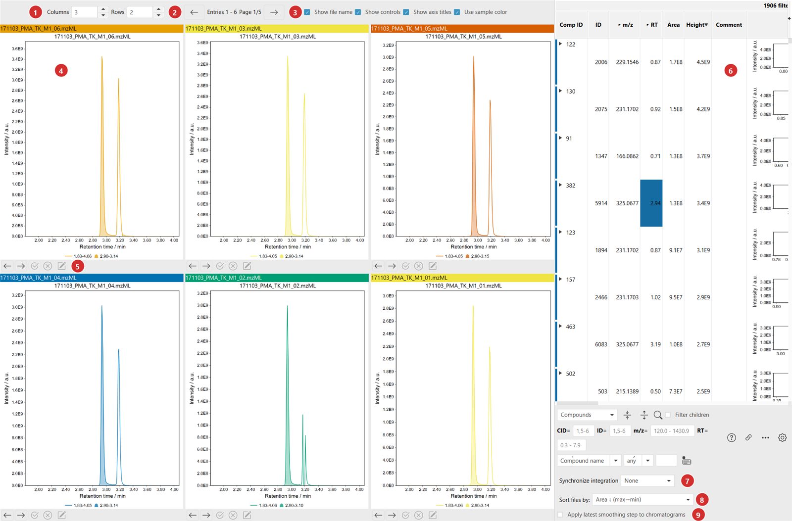
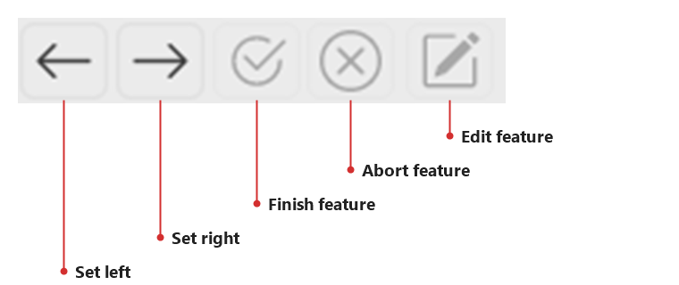

# Integration dashboard

:material-menu-open: **Visualization → Feature list → Dashboards → Integration dashboard**

The integration dashboard shows the extracted ion chromatograms (EICs) of a single feature list row
in all raw data files of a feature list side by side. It is used to review peak integration across
samples and to manually (re-)integrate features, either file by file or by transferring one
integration to all other files.

The dashboard can be opened in several ways:

- Right click on a feature list in the main window → **Show integration dashboard**.
- **Visualization → Feature list → Dashboards → Integration dashboard**.
- From the quick module access (++ctrl+f++ / ++cmd+f++ or double ++shift++), searching for
  _Integration dashboard_.

The dashboard opens for one feature list. There is no parameter dialog; when opened from the menu,
the feature list selected in the main window is used.

!!! warning

    Manual integrations change the features **in the current feature list directly**. Unlike
    processing modules, the dashboard does not create a new feature list. If you want to keep the
    original integration, duplicate the feature list or save the project before you start.

---

## Layout

1. Number of columns and rows of the plot grid
2. Page navigation through the raw data files
3. Display options of the plots
4. Chromatogram plot of one raw data file, with the file name as title
5. Integration buttons of this plot (see [Manual integration](#manual-integration))
6. Feature table, select a row to show its chromatograms
7. Synchronize integration across files
8. Sort order of the plots
9. Apply the smoothing of the feature list to the chromatograms

The dashboard is split into two parts:

- **Left:** a grid of chromatogram plots, one plot per raw data file. Each plot shows the EIC of
  the selected row and, if present, the integrated feature as a filled area.
- **Right:** the feature table of the feature list. Below the table are the controls for
  synchronized integration, sorting and smoothing.

Select a row in the feature table to load its chromatograms in all files. The plots share one
cursor, so a position clicked in one plot is marked in all plots.

### Displayed chromatograms

For each raw data file, mzmine extracts a chromatogram from the scans that were used to build the
feature list:

- **Retention time range:** centered on the average retention time of the row. The window is three
  times as wide as the retention time range of the row, so the surrounding baseline is visible.
- **m/z range:** if a feature was detected in the file, the m/z range of its raw data points is
  used. If no feature was detected, a window of 0.005 _m/z_ or 10 ppm (whichever is larger) around
  the average _m/z_ of the row is used.
- **Ion mobility data:** for ion mobility features, only the mobility range of the feature is
  extracted.
- **MRM data:** the chromatogram of the quantifier transition is shown. All transitions of the
  feature are drawn as additional traces, labeled _Q1 → Q3_. In MRM feature lists, files without a
  feature for the selected row show an empty plot.
- **Imaging data files** are skipped.

## Controls

### Plot grid

The controls above the plots define the grid and the appearance of the plots.

**Columns / Rows** Number of plots per row and column of the grid (1 to 30). Default: 3 columns and
2 rows. If there are more raw data files than plots on one page, use the arrow buttons to switch
between pages. The label next to the arrows shows the displayed entries and the current page.

**Show file name** Shows the name of the raw data file as title above each plot.

**Show controls** Shows the integration buttons below each plot (see
[Manual integration](#manual-integration)).

**Show axis titles** Shows the titles of the x and y axes in each plot.

**Use sample color** Draws each plot in the color of its raw data file, as defined in the sample
metadata. If disabled, all plots use the same default colors.

### Feature table controls

**Synchronize integration** Defines whether a manual integration in one file is transferred to the
other files. The transferred information is the retention time range of the integration. Each file
is integrated within this range on its own chromatogram.

- **None** _(default)_: Integrations are not transferred. Each file must be integrated manually.
- **All**: A new integration is transferred to all other files and overrides their current
  integration.
- **Only missing**: A new integration is transferred only to files in which no feature was
  detected for the selected row.

**Sort files by** Defines the order of the plots in the grid.

- **Metadata: _column_**: Sorts the files alphabetically by the value of a metadata column. Default:
  the sample type column.
- **Area ↑ (min→max)** / **Area ↓ (max→min)**: Sorts the files by the area of the feature in the
  selected row. Files without a feature are treated as area 0. The order is updated when an
  integration changes.

**Apply latest smoothing step to chromatograms** If the feature list was smoothed along the
retention time dimension, the same smoothing is applied to the displayed chromatograms. Enable this
option to integrate on the same type of data as the automatic feature detection. Default: disabled.

!!! note

    Only retention time smoothing is applied to the chromatograms. Baseline correction steps of
    the feature list are not applied in the dashboard.

## Manual integration {#manual-integration}

Each plot has its own integration controls. In the dashboard, the buttons only show icons; hover
over a button to see its name.

| Button                                             | Windows / Linux                    | macOS                                     | Description                                                                |
|----------------------------------------------------|------------------------------------|-------------------------------------------|----------------------------------------------------------------------------|
| :material-arrow-left: **Set left**                 | ++ctrl++ + left click              | ++ctrl++ (⌃) + click                      | Sets the left boundary (start retention time) of the integration.          |
| :material-arrow-right: **Set right**               | ++ctrl+shift++ + left click        | ++ctrl+shift++ (⌃⇧) + click               | Sets the right boundary (end retention time) of the integration.           |
| :material-check-circle-outline: **Finish feature** | ++alt++ + left click               | ++option++ (⌥) + click                    | Integrates the chromatogram between the boundaries and saves the feature.  |
| :material-close-circle-outline: **Abort feature**  |                                    |                                           | Discards the current boundaries without changing the feature.              |
| :material-pencil-box-outline: **Edit feature**     |                                    |                                           | Loads the boundaries of the selected feature so they can be adjusted.      |

!!! note "macOS"

    On macOS, the integration shortcuts use the **Control** key (⌃), not the Command key (⌘).

After pressing **Set left** or **Set right**, a regular left click in the plot sets the respective
boundary. The keyboard shortcuts set the boundaries directly without pressing a button first. To
edit an existing feature, click inside the integrated area to select it and press **Edit feature**.

Each file holds at most one feature per row. A new integration replaces the existing feature of
this file.

When an integration is finished:

- If the row already had a feature in this file, its data is replaced by the new integration.
- If the row had no feature in this file, a new feature is added to the row.
- In both cases, the detection status of the feature is set to **MANUAL** and the values that depend
  on the feature data (e.g., area, height, retention time) are recalculated.
- If the integrated area is zero, the feature is removed from the row.

!!! tip

    To quickly fill gaps in a row, set **Synchronize integration** to **Only missing**, integrate
    the peak in one file that contains a well-defined feature and check the transferred
    integrations in the other files.

## Applied method record

Manual integrations are recorded in the applied methods of the feature list as **Integration
dashboard - Manual integration**. For each integrated row and file, the record stores the row, the
raw data file, the _m/z_ range of the chromatogram, the integrated retention time range, the
mobility range and whether the feature was removed. It also stores whether
**Apply latest smoothing step to chromatograms** was enabled.

The record is written when you select another row, switch to a different feature list or close the
dashboard. All integrations of one open dashboard are collected in a single record. If this record
is still the latest applied method of the feature list, it is updated instead of added again.
Opening the dashboard again creates a new record.

---

{{ git_page_authors }}
