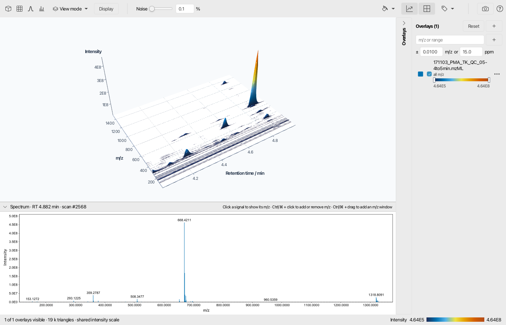
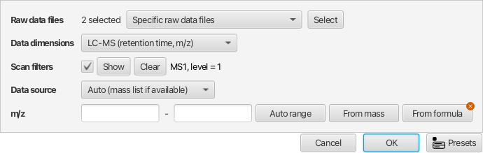
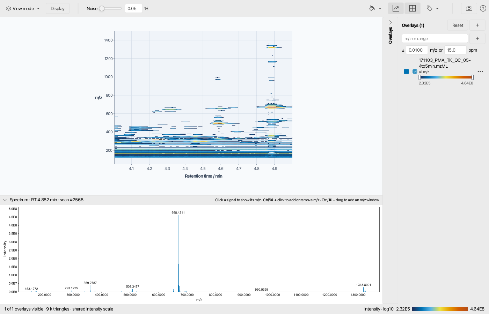
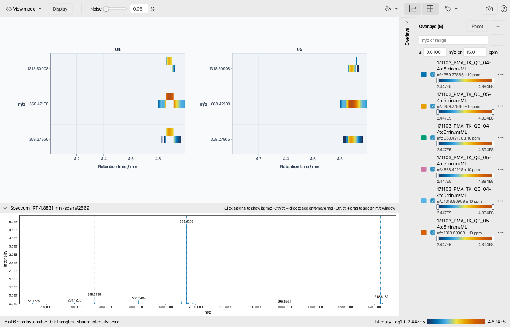
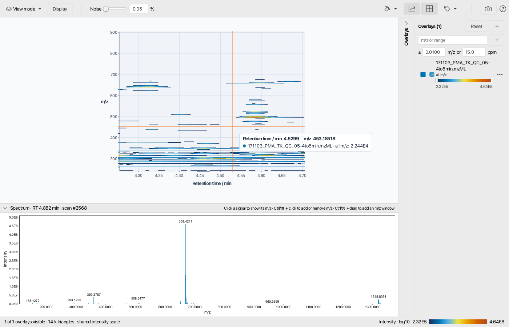
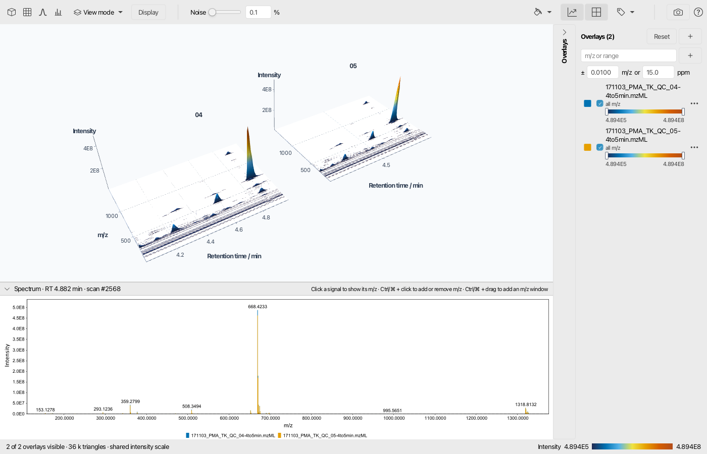
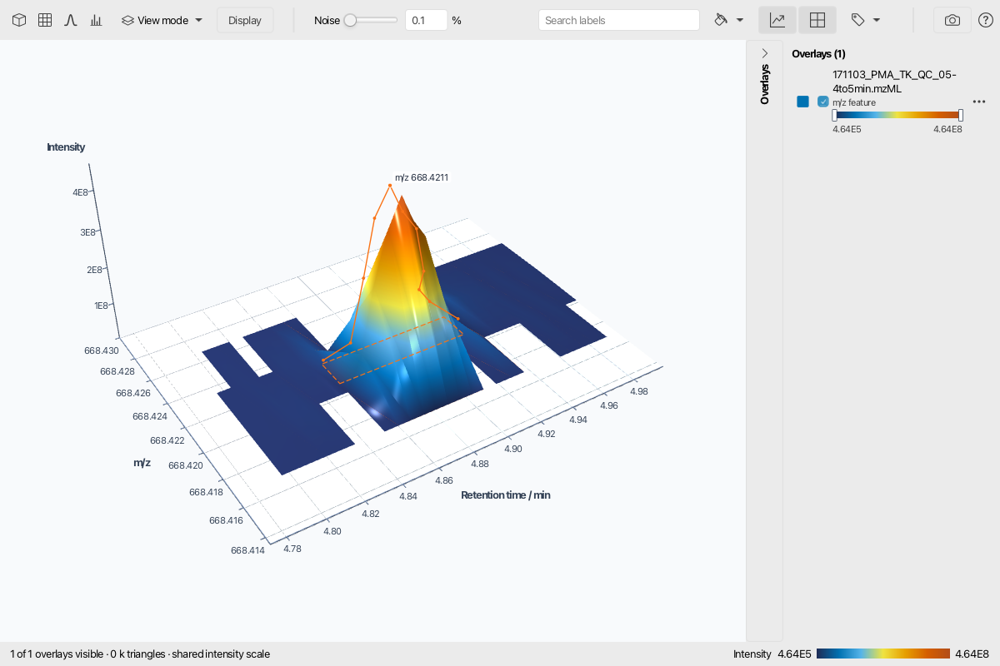
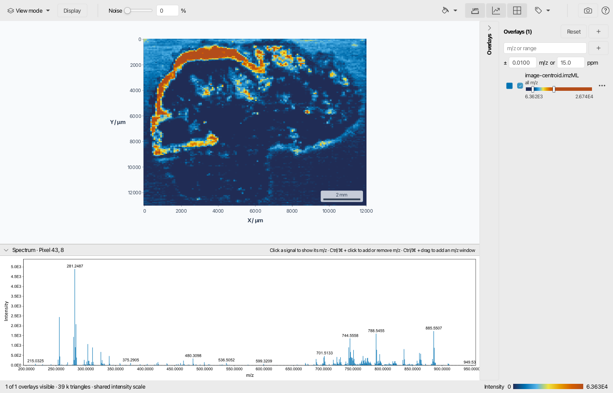
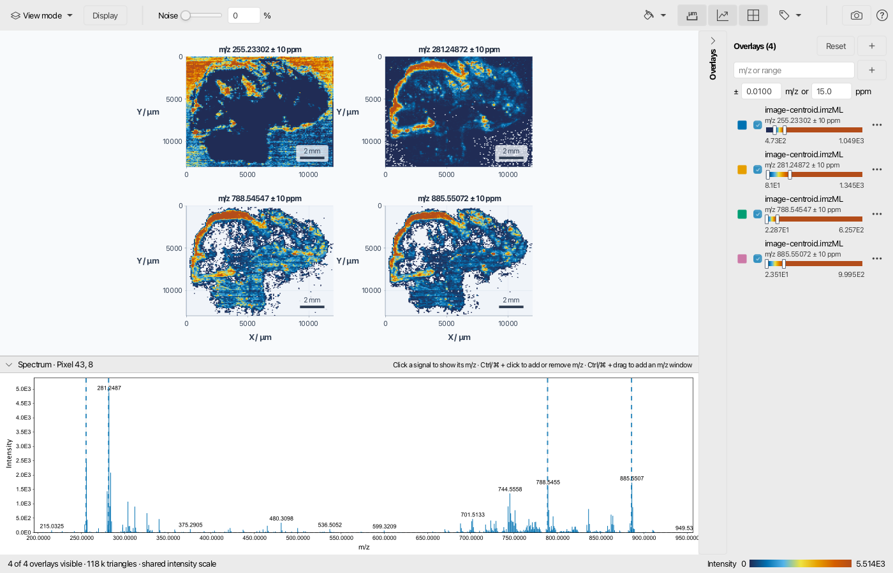
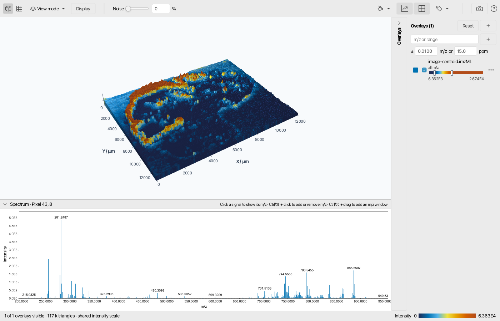

# 2D and 3D visualizer

:material-menu-open: **Visualization → Raw data → 2D visualizer** or **3D visualizer**

The 2D and 3D visualizers show raw data as an intensity map: a flat, color-coded map in the 2D
visualizer and a relief in the 3D visualizer. Both share one interface and work with LC-MS and
GC-MS data, ion mobility data, and imaging data. Several raw data files and m/z windows can be
compared in one view, either overlaid or side by side.

The axes follow the data:

| Data                 | x axis         | y axis       | Intensity            |
|----------------------|----------------|--------------|----------------------|
| LC-MS, GC-MS         | Retention time | m/z          | Color, height in 3D  |
| Ion mobility         | Retention time | Mobility     | Color, height in 3D  |
| Ion mobility frame   | m/z            | Mobility     | Color, height in 3D  |
| Imaging              | x / µm         | y / µm       | Color, height in 3D  |

The visualizers read only what the view needs. Zooming in reads the visible part of the data again,
at about one data point per screen pixel in the 2D visualizer, so details appear as you zoom. Parts
that were already read stay sharp while panning.

## Recommended citations

!!! info

    When using mzmine for your work, please consider citing: 
    Schmid R., Heuckeroth S., Korf A., et al. Integrative analysis of multimodal mass spectrometry data in MZmine 3, Nature Biotechnology (2023), doi:10.1038/s41587-023-01690-2.

---

## Opening the visualizers

- **Visualization → Raw data → 2D visualizer** or **3D visualizer** opens the parameter dialog for
  the raw data files selected in the project.
- **Right-click on raw data files → Show 2D visualizer** or **Show 3D visualizer** does the same
  from the raw data list.
- **Double-click on an imaging file** opens it as an image in the 2D visualizer.
- **Right-click on a feature list row:**
    - **Feature in 2D** and **Feature in 3D** open the feature in all raw data files of the feature
      list, side by side, see [Features from the feature table](#features-from-the-feature-table).
    - **Image** opens the image of an imaging feature.
    - **Co-located images** opens the image of the feature together with its co-located images,
      most similar first, after [image co-localization](../../module_docs/group_imagecorrelate/image-colocalization.md).

!!! warning

    Raw data files of different types cannot be combined in one view. LC-MS, ion mobility frames,
    and imaging files have to be opened separately.

---

## Parameters

#### Raw data files

The raw data files to show, one overlay per file. Several files open side by side.

#### Data dimensions

- **Automatic:** imaging files show images, all other files retention time and m/z.
- **LC-MS (retention time, m/z):** for LC-MS and GC-MS data.
- **Ion mobility (retention time, mobility):** ion mobility data with retention time against
  mobility, see [Ion mobility data](#ion-mobility-data). Files without ion mobility show retention
  time and m/z instead.
- **Ion mobility frame (m/z, mobility):** one frame of ion mobility data, see
  [Ion mobility data](#ion-mobility-data).
- **Imaging (x, y):** imaging data.

#### Scan filters

Selects the scans, e.g. MS level, polarity, or a retention time range. For LC-MS data, only the
scans of the lowest selected MS level are shown, usually MS1. For imaging data, the retention time
filter is ignored, since pixels have no meaningful retention time.

For ion mobility data, a mobility range limits the data to the mobility scans inside the range.
Retention time against m/z and images then sum only these mobility scans instead of the complete
frames, so ions separated by their mobility are not mixed.

See [Scan selection filters](../../module_docs/scan_selection/scan_selection.md) for all options.

!!! warning

    If the scan filters match no scans of a file, e.g. positive polarity for negative mode data,
    a warning on top of the plot names the file.

#### Data source

- **Auto (mass list if available):** uses the mass list of a scan if it has one, otherwise its raw
  data points. This is decided for every scan, so partly processed files still show all scans.
- **Raw data:** always the raw data points.
- **Mass list:** only mass lists, which requires
  [mass detection](../../module_docs/featdet_mass_detection/mass-detection.md). If none of the
  selected scans has a mass list, a warning asks to run mass detection or to use the raw data.

#### m/z _(Optional)_

Limits the m/z range. Leave it empty for the complete range of the files.

---

## The view

The toolbar is on top, the overlays are listed on the right, and the spectrum at the selected
position is shown below the plot.

### Toolbar

- **View buttons** _(3D only)_: fit the 3D view, look from the top, or show the profile along one
  axis (front and side view). Images have no profile views.
- **View mode:**
    - **Overlay** draws all overlays at their coordinates.
    - **Side by side** shows small multiples with linked rotation and zoom. It is selected
      automatically when several files are opened.
- **Display:** options that apply to the current data:
    - **Height** _(3D)_: vertical exaggeration.
    - **Transform** and **Heights** _(3D images)_: transformation of the heights, and whether the
      weakest pixel starts at the floor.
    - **Colors** _(2D)_: transformation of the colors, e.g. log10 or square root to show weak
      signals.
    - **Normalize** _(images)_: normalizes the intensity of every pixel, e.g. to the TIC. The data
      are read again.
    - **Overlays** _(several overlays)_: scales every overlay to its own maximum, e.g. to compare
      ions of different abundance.
    - **Color by:** colors the data by intensity or by the color of their overlay.
    - **Paint scale:** the paint scale of the intensity colors.
    - **Smoothing:** Gaussian smoothing over a number of neighboring data points, along both axes
      or one of them. 0 turns it off.
    - **Tiles** _(side by side)_: number of columns and rows, Auto for a square grid.
- **Noise:** hides signals below a percentage of the maximum to remove the noise carpet. The
  default is 0.05 % in 2D and 0.1 % in 3D. Images start at 0 %.
- **Plot background:** the background color, the theme default or any color.
- **Scale bar** _(2D images with a pixel size)_: a scale bar in the lower right corner of every
  image.
- **Axes:** shows or hides axis lines, ticks, and axis titles.
- **Grid lines:** shows or hides the grid.
- **Labels:** shows or hides all text and chooses the feature list for the peak labels, see
  [Feature labels](#feature-labels). In the 3D visualizer, **Feature outlines and traces** shows or
  hides the stored data of features opened from the feature table.
- **Camera:** saves the current view as a PNG image.
- **?:** the mouse and keyboard controls.

### Overlays

Every overlay is one raw data file with one m/z window. The panel on the right lists them:

- The color square changes the overlay color, the checkbox shows or hides the overlay.
- The **color range** slider spans zero to the maximum intensity. Drag its handles to clip the
  colors: everything below the low handle gets the lowest color, everything above the high handle
  the highest color, and the whole paint scale lies in between. Double-click resets the range.
- The **···** menu, also on right click, sets the opacity, shows only this overlay, or removes it.
- **+** next to the title adds the raw data files selected in the project.
- **Reset** shows the complete m/z range again and removes all m/z windows.

#### Adding m/z windows

Enter m/z values or ranges, separated by commas, e.g. `400.1234, 512.3-512.5`, and press **+**.
Single values use the tolerance below the field, by default 0.01 m/z or 15 ppm, whichever is
larger. Every m/z window is added for every raw data file.

The spectrum below the plot offers the same:

- Click a signal to show its m/z window for all files instead of the current ones.
- Ctrl/⌘ + click adds an m/z window, or removes it if the click falls into a shown window.
- Ctrl/⌘ + drag adds the dragged m/z range.

Shown m/z windows are marked in the spectrum.

Several narrow m/z windows of LC-MS or GC-MS data are drawn as lanes: every window gets a band of
the same height, labeled with its center m/z, and all windows of one raw data file share one tile
side by side. Without an m/z axis, e.g. retention time against mobility, every m/z window gets a
tile of its own, since the windows would cover each other.

### Navigation

| Action                       | 2D visualizer                         | 3D visualizer                                 |
|------------------------------|---------------------------------------|-----------------------------------------------|
| Pan                          | Drag, arrow keys, two-finger scroll   | Shift + drag, right drag, two-finger scroll   |
| Rotate                       | –                                     | Drag, arrow keys                              |
| Zoom at the cursor           | Mouse wheel, pinch                    | Mouse wheel, pinch                            |
| Zoom                         | + and −                               | + and −                                       |
| Zoom to a box                | Ctrl/⌘ + drag                         | Ctrl/⌘ + drag on the floor                    |
| Fit the view, show all data  | Double-click, R                       | Double-click, R                               |
| Top, front, side view        | –                                     | T, F, S                                       |
| Show the spectrum            | Click                                 | Click                                         |

- Hovering shows the position and the intensity of every overlay there.
- Side by side, double-clicking a tile fits the view to it.
- Side by side, Ctrl/⌘ + drag zooms all tiles to the same data range at once, and the camera
  stays in place.
- The 2D visualizer does not zoom out further than the complete data.

---

## Feature labels

The labels menu in the toolbar chooses a feature list whose features are labeled at their apex,
e.g. with the annotation name or the m/z, followed by the ion notation. Opening a feature from the
feature table selects its feature list automatically.

- **Search labels** in the toolbar shows only the labels that contain the text, e.g. a compound
  name, an ion, or an m/z.
- **Annotated only** shows only labels of annotated features.
- **Hovering a label** highlights the features grouped with it and their isotopes, and dims the
  rest of the data. Groups come from the compound grouping, the ion identity networks, or the
  pseudo spectra of GC-EI deconvolution.
- **Clicking a label** moves the camera to the feature.
- Further ions of a compound are labeled only next to the shown label of their compound.

Images get no peak labels. Instead, the annotations of the chosen feature list are added to the
image titles.

[//]: # (TODO add a screenshot of feature labels with a processed feature list)

---

## Features from the feature table

**Feature in 2D** and **Feature in 3D** open the parameter dialog prefilled with the bounds of the
selected features, taken from the feature data:

- the m/z windows of the features,
- their retention time range,
- for ion mobility data, their mobility range.

All raw data files of the feature list are shown side by side, and the features of the same rows in
the other samples are included, so retention time shifts between samples stay in view. The feature
list labels the peaks. The view shows the raw data inside these bounds: neighboring signals,
isotopes, and noise stay visible as context around the features.

Features resolved in mobility keep that dimension: LC-IMS-MS features open with retention time
against mobility, and images of IMS imaging features sum only the mobility scans in the mobility
range of the features.

When several features are opened together, all tiles share one window that spans all of them, so a
single feature may cover only a part of it. In the 3D visualizer, every opened feature therefore
shows its stored data on top of the raw data:

- a dashed **outline** on the floor marks the retention time and m/z range of the feature, or its
  retention time and mobility range,
- the stored **ion trace** follows the data points of the feature, e.g. to spot a trimmed tail or a
  merged neighbor.

**Feature outlines and traces** in the labels menu turns both off.

---

## Imaging data

Images open in the 2D visualizer with x and y in µm if the file contains the pixel size, otherwise
in pixels. As in the image viewer of mzmine, the origin is at the top left, and every image starts
with its color range at the 50 % and 98 % quantiles of its intensities.

- Several m/z windows of one file are shown side by side, one image each. The titles show the m/z
  and, with a feature list chosen in the labels menu, the annotations in this window.
- The scale bar button adds a scale bar of a round length, in µm or mm, to every image. It is only
  offered for files with a pixel size in the 2D visualizer, since perspective makes lengths change
  across a 3D view. Hiding the labels or axes keeps the scale bar.
- **Co-located images** in the feature table opens all co-located images side by side.
- For IMS imaging data, **Image**, **Feature in 2D**, and **Feature in 3D** sum only the mobility
  scans in the mobility range of the features, see [Scan filters](#scan-filters).

In the 3D visualizer, images are drawn as pixel columns. By default, heights are log10 scaled and
start at the weakest pixel, so differences stand out.

---

## Ion mobility data

### Retention time and mobility

With **Ion mobility (retention time, mobility)** as data dimensions, the visualizers show
retention time on the x axis and mobility on the y axis. Every overlay sums the intensity of its
m/z window in every mobility scan, so ions of the same m/z that differ in mobility appear as
separate peaks. Clicking the map shows the spectrum of the mobility scan at that position.

LC-IMS-MS features open in this view from the feature table. A mobility range in the scan filters
limits the mobility axis.

### Mobility frames

With **Ion mobility frame (m/z, mobility)** as data dimensions, the visualizers show one frame
with m/z on the x axis and mobility on the y axis. Instead of a spectrum, a base peak
chromatogram of the frames is shown below the plot: click it to show the closest frame, or
Ctrl/⌘ + drag to average the frames of a retention time range.

---

{{ git_page_authors }}
